**RELATÓRIO INSTITUCIONAL DE MONITORAMENTO – GERAL**

3º bimestre/2026

# **Sumário**

[1 INTRODUÇÃO [5](#introdução)](#introdução)

[2. ANÁLISE CONSOLIDADA DA EXECUÇÃO DO PPAG 2024 - 2027, EXERCÍCIO 2026 [7](#análise-consolidada-da-execução-do-ppag-2024---2027-exercício-2026)](#análise-consolidada-da-execução-do-ppag-2024---2027-exercício-2026)

[2.1 EXECUÇÃO GLOBAL ATÉ O 3º BIMESTRE DE 2026 [7](#execução-global-até-o-2º-bimestre-de-2026)](#execução-global-até-o-2º-bimestre-de-2026)

[2.2 DESEMPENHO CONSOLIDADO DAS AÇÕES [12](#desempenho-consolidado-das-ações)](#desempenho-consolidado-das-ações)

[2.3 REGIONALIZAÇÃO DOS PROGRAMAS [17](#regionalização-dos-programas)](#regionalização-dos-programas)

[2.5 DETALHAMENTO DA EXECUÇÃO DA DESPESA DE PESSOAL E AUXÍLIOS [34](#execução-orçamentária-nos-municípios-classificados-no-extrato-identificado-como-de-baixo-desempenho-do-imrs)](#execução-orçamentária-nos-municípios-classificados-no-extrato-identificado-como-de-baixo-desempenho-do-imrs)

[DEMONSTRATIVO DO DESEMPENHO FÍSICO‐ORÇAMENTÁRIO DO PPAG [37](#_Toc1507264232)](#_Toc1507264232)

**Lista de Gráficos**

[**Gráfico 1** - Porcentagem de ações com programação para o período segundo intervalos de desempenho físico e orçamentário - Minas Gerais - 3º bimestre de 2026 [15](#_Toc236806289)](#_Toc236806289)

[**Gráfico 2** - Percentual de ações de acompanhamento geral e intensivo, com programação para o período, segundo intervalos de desempenho físico e orçamentário - Minas Gerais - 3º bimestre de 2026 [17](#_Toc236806290)](#_Toc236806290)

**Lista de Tabelas**

[**Tabela 1** - Programação e execução dos programas por tipo de orçamento - Minas Gerais - 3º bimestre de 2026 [8](#_Toc236806135)](#_Toc236806135)

[**Tabela 2** -Programação e execução dos programas por tipo de acompanhamento de ação - Minas Gerais - 3º bimestre de 2026 [9](#_Toc236806136)](#_Toc236806136)

[**Tabela 3** - Programação e execução dos programas por Área Temática - Minas Gerais - 3º bimestre de 2026 [10](#_Toc236806137)](#_Toc236806137)

[**Tabela 4** - Programação e execução dos programas por função - Minas Gerais - 3º bimestre de 2026 [12](#_Toc236806138)](#_Toc236806138)

[**Tabela 5** - Ações válidas de todos os programas do PPAG segundo intervalos de desempenho físico e orçamentário - Minas Gerais - 3º bimestre de 2026 [14](#_Toc236806139)](#_Toc236806139)

[**Tabela 6** - Ações válidas de todos os programas do PPAG segundo intervalos de desempenho e IAG (Identificador de Ação Governamental) - Minas Gerais - 3º bimestre de 2026 [16](#_Toc236806140)](#_Toc236806140)

[**Tabela 7** - Valor global programado e executado nos programas por Região Geográfica Intermediária - Minas Gerais - 3° bimestre de 2026 [20](#_Toc108083391)](#_Toc108083391)

[**Tabela 8** - Gasto per capita\* programado e executado nos programas por Região Geográfica Intermediária - Minas Gerais - 3° bimestre de 2026 [23](#_Toc236806142)](#_Toc236806142)

[**Tabela 9** **-** Demonstrativo dos Recursos Programados e Aplicados, por Programa, no Desenvolvimento Social dos Municípios Classificados nas Cinquenta Últimas Posições do IMRS – Minas Gerais - 3º bimestre de 2026 [27](#_Toc236806143)](#_Toc236806143)

[**Tabela 10 -** Demonstrativo dos Recursos Aplicados no Desenvolvimento Social dos Municípios Classificados nas Cinquenta Últimas Posições do IMRS – 3º bimestre de 2026 - Áreas Temáticas [29](#_Toc236806144)](#_Toc236806144)

[**Tabela 11** - Demonstrativo dos Recursos Programados e Aplicados nos Municípios Classificados nas Cinquenta Últimas Posições do IMRS – Minas Gerais - 3º bimestre de 2026 [32](#_Toc236806145)](#_Toc236806145)

[**Tabela 12 -** Programação e Execução da Despesa de Pessoal e Auxílios por Setor de Governo - Minas Gerais - 3º bimestre de 2026 [35](#_Toc236806146)](#_Toc236806146)

**Lista de Mapas**

[**Mapa 1** - Regiões Geográficas Intermediárias de Minas Gerais – IBGE [19](#_Toc170986881)](#_Toc170986881)

[**Mapa 2** - Gasto Global Programado por Região Geográfica Intermediária – Minas Gerais – 2026 [21](#_Toc108083399)](#_Toc108083399)

[**Mapa 3** - Gasto Global Executado por Região Geográfica Intermediária –Minas Gerais – 3° Bimestre 2026 [21](#_Toc108083400)](#_Toc108083400)

[**Mapa 4** - Gasto Global Programado *Per Capita* por Região Geográfica Intermediária – Minas Gerais – 2026 [24](#_Toc170986884)](#_Toc170986884)

[**Mapa 5 -** Gasto Global Executado *Per Capita* por Região Geográfica Intermediária – Minas Gerais – 3° Bimestre 2026 [24](#_Toc108083402)](#_Toc108083402)

[**Mapa 6** – Valor Global Programado nos Municípios Classificados nas Cinquenta Piores Posições do IMRS – Minas Gerais – 2026 [33](#_Toc170986886)](#_Toc170986886)

[**Mapa 7** - Valor Global Executado nos Municípios Classificados nas Cinquenta Últimas Posições do IMRS – Minas Gerais – 3° Bimestre de 2026 [33](#_Toc170986887)](#_Toc170986887)

# **1 INTRODUÇÃO** 

O Relatório Institucional de Monitoramento (RIM) apresenta, bimestralmente, informações consolidadas sobre o desempenho físico e orçamentário das ações e programas contidos no Plano Plurianual de Ação Governamental (PPAG) do Estado de Minas Gerais. Como principal objetivo, o RIM viabiliza o monitoramento da execução do PPAG, apresentando-se como uma síntese das atividades desenvolvidas na concreção de suas metas físicas e orçamentárias.

Nesse sentido, o RIM constitui-se não apenas em uma ferramenta de gestão governamental, mas sobretudo em um importante instrumento de promoção da transparência pública. As informações divulgadas pelo relatório evidenciam o desempenho da administração estatal, de modo a reforçar o compromisso do Estado com os princípios democráticos e com o fortalecimento da participação cidadã. Ademais, ressalta-se que as análises do RIM municiam as audiências públicas de monitoramento da execução do PPAG que são elaboradas pela Assembleia Legislativa de Minas Gerais (ALMG), garantindo ativamente o funcionamento da fiscalização institucional.

As normas que disciplinam a elaboração do RIM estão majoritariamente previstas no art. 12 da Lei Estadual nº 24.677/2024, que institui o Plano Plurianual de Ação Governamental para o período de 2024 a 2027:

> Art. 12. Para fins de monitoramento do PPAG 2024-2027, serão elaborados relatórios institucionais de monitoramento, os quais terão periodicidade bimestral e conterão, no mínimo, os seguintes documentos:
>
> I – demonstrativo de programação e execução regionalizada das metas físicas e financeiras das ações e dos programas do PPAG 2024-2027, contendo demonstrativo específico das ações classificadas como projetos estratégicos;
>
> II – demonstrativo de desempenho das ações que compõem os programas sociais;
>
> III – boletim com informações consolidadas acerca da execução, do desempenho e da regionalização física e financeira das ações do PPAG 2024-2027 até o período monitorado.
>
> § 1º – Consideram-se programas sociais, para efeitos desta lei, as políticas orientadas para a emancipação social e cidadã, envolvendo programas precipuamente voltados para agricultura, assistência social, segurança alimentar, ciência e tecnologia, cultura, desporto e lazer, direitos humanos e de cidadania, educação, habitação, meio ambiente, organização agrária, previdência social, saneamento, saúde, segurança pública, trabalho, transporte e urbanismo.

De modo complementar, as Leis Orçamentárias Anuais (LOAs) também versam sobre a transparência fiscal e instituem demais obrigações periódicas. Ao tratar das diretrizes gerais para a elaboração e a execução orçamentária, por exemplo, a Lei nº 25.440 de 06 de agosto de 2025 dispõe a seguinte exigência:

> Art. 49 – Para fins de transparência da gestão fiscal e em observância ao princípio da publicidade, o Poder Executivo tornará disponíveis na internet, no Portal da Transparência do Estado de Minas Gerais, de forma transparente, clara e em linguagem de fácil compreensão, as seguintes informações de interesse público:
>
> III – a execução bimestral das metas físicas e orçamentárias do PPAG;

Em vista desse contexto, o Estado de Minas Gerais divulga bimestralmente as informações da execução física e orçamentária de todas as ações inseridas na programação de seu PPAG.

Para este fim, o RIM subdivide seu conteúdo conforme as seguintes apreciações:

- *Análise Consolidada da Execução*, na qual são apresentadas as informações sobre a programação e a execução das despesas, por: I- tipo de orçamento, II- tipo de acompanhamento, III- áreas temáticas, IV- funções e V- regionalização;

- *Análise Consolidada da Execução nos Municípios com Baixo Índice Mineiro de Responsabilidade Social (IMRS),* na qual se destaca a programação e a execução das despesas nos municípios com os menores valores de IMRS;

- *Análise do Desempenho Físico-Orçamentário,* na qual se observa os status das ações em: I- satisfatório, II- crítico, III- subestimado e IV- sem execução.

- Análise Consolidada da Execução da Despesa de Pessoal e Auxílios, na qual são demonstradas as informações do valor programado e executado por Setor de Governo.

# **ANÁLISE CONSOLIDADA DA EXECUÇÃO DO PPAG 2024 - 2027, EXERCÍCIO 2026**

## 2.1 EXECUÇÃO GLOBAL ATÉ O 2º BIMESTRE DE 2026

A análise bimestral da execução considera o valor total da despesa programada no PPAG, isto é, o valor integral a ser realizado pela ação durante o ano, e o correlaciona com o valor programado até o bimestre vigente, isto é, com o valor parcial planejado pela ação em função dos 6 bimestres anuais. Tais metas são fixadas pelos gestores de cada órgão durante a de elaboração ou a revisão do PPAG, sendo inseridas de forma técnica e procedimental no sistema de planejamento utilizado pelo Estado (SIGPlan).

Com o objetivo de evidenciar a natureza das informações, a análise consolidada da execução será segmentada nos seguintes estratos: I- tipo de orçamento, II- tipo de acompanhamento, III- áreas temáticas, IV- funções e V- regionalização. A explicação funcional de cada uma destas categorias será demonstrada abaixo e, em seguida, serão apresentados seus respectivos dados e as análises.

As ações que compõem o PPAG podem ser detalhadas levando em consideração um dos dois tipos de orçamento existentes:

> ● Orçamento fiscal, que abrange todas as despesas correntes (categoria 3) e de capital (categoria 4) referentes a todos os Poderes do Estado, os seus fundos, órgãos e entidades da administração direta e indireta - inclusive as fundações instituídas e mantidas pelo Poder Público, além das empresas estatais dependentes;
>
> ● Orçamento de investimento das empresas controladas pelo Estado, que compreende apenas despesas de investimento das empresas em que o governo mineiro, direta ou indiretamente, detenha maioria do capital social com direito a voto.

A seguir, a Tabela 1 apresenta os valores globais programados, de forma consolidada, bem como a execução por cada tipo de orçamento até o segundo bimestre de 2026:

Tabela 1 - Programação e execução dos programas por tipo de orçamento - Minas Gerais - 2º bimestre de 2026

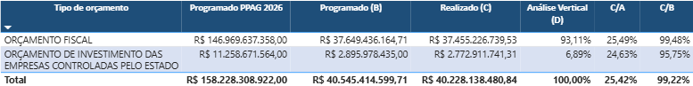

A partir dos dados, constata-se a preponderância do orçamento fiscal em relação ao orçamento de investimento. No segundo bimestre de 2026, 93,11% dos recursos realizados pertenceram ao orçamento fiscal, enquanto apenas 6,89% foram alocados no orçamento de investimento. Além disso, é possível observar uma maior aderência da execução do orçamento fiscal em relação aos recursos programados para o período, haja vista que 99,48% dos recursos programados foram realizados, enquanto no orçamento de investimento essa relação atingiu 95,75%. Por fim, quando se verifica a análise global, é possível observar que houve a execução de 99,22% dos recursos orçamentários totais programados para o período.

Ademais, as ações do PPAG também podem ser analisadas levando em consideração o tipo de acompanhamento, isto é, considerando a metodologia adotada no seu monitoramento:

- Projetos Estratégicos: compreendem as ações prioritárias, compondo a linha fundamental de atuação do governo. Geralmente são ações com alto potencial de impacto e que, por isso, dispõem de um acompanhamento pormenorizado;

- Demais Projetos e Atividades: referem-se às ações que contemplam as prioridades setoriais de cada órgão, mas que não estão diretamente vinculadas à linha fundamental de atuação do governo. Em geral, essas ações englobam atividades com foco na manutenção e melhoria da própria máquina pública.

A seguir, a Tabela 2 apresenta a distribuição dos valores programados e realizados conforme o tipo de acompanhamento:

Tabela 2 -Programação e execução dos programas por tipo de acompanhamento de ação - Minas Gerais - 2º bimestre de 2026

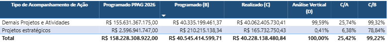

A partir dos dados, constata-se que os Demais Projetos e Atividades executaram a maior fatia dos recursos, representando 99,59% do valor total executado, enquanto a realização dos Projetos Estratégicos representou apenas 0,41%. Isso ocorre pela distribuição das ações, em que, de um total de 1007, 45 são classificadas como Projetos Estratégicos e 962 são classificadas como Demais Projetos e Atividades. Apesar dessa concentração, é possível verificar que o tipo de acompanhamento não confere primazia às execuções orçamentárias, de modo que o percentual das despesas realizadas em função das despesas programadas é de 99,32% para as ações do tipo Demais Projetos e 78,84% para as do tipo Projetos Estratégicos.

Ademais, é possível analisar as ações do PPAG conforme suas respectivas áreas de atuação. O Plano Mineiro de Desenvolvimento Integrado (PMDI) determina – além da visão de futuro, objetivos estratégicos e diretrizes gerais que orientam as ações governamentais – aquilo que vem a ser as áreas temáticas atuação:

- Áreas Temáticas Finalísticas: são atribuídas às políticas que produzem resultados diretos para os cidadãos, sendo elas responsáveis por consolidar as transformações necessárias em vistas dos objetivos e princípios estratégicos definidos no PMDI. Tais políticas dirigem seus esforços em operações de transformação ou melhoria, a fim concretizar às metas de médio e longo prazo também estipuladas no PMDI;

- Áreas Temáticas de Apoio e Suporte: são atribuídas às políticas que fornecem todo o subsídio necessário às demais atividades finalísticas. Mesmo não entregando serviços diretos à população, elas são as responsáveis por possibilitar todas as políticas finalísticas, na medida em que subsidiam todas as suas operações, sendo o ponto de partida para o alcance de qualquer meta ou resultado.

Existem 14 áreas temáticas, sendo 9 delas definidas como áreas finalísticas e 5 delas definidas como áreas suporte:

- Áreas Temáticas Finalísticas: (1) Agricultura, Pecuária e Abastecimento; (2) Cultura e Turismo; (3) Desenvolvimento Econômico; (4) Desenvolvimento Social; (5) Educação; (6) Infraestrutura e Mobilidade; (7) Meio Ambiente; (8) Saúde; e (9) Segurança Pública;

- Áreas Temáticas de Apoio e Suporte: (10) Advocacia-Geral, (11) Fazenda, (12) Governo e Gabinete Militar, (13) Planejamento e Gestão e (14) Transparência, Combate à Corrupção, Integridade e Ouvidoria.

A seguir, a Tabela 3 demonstra a execução global a partir dessas Áreas:

Tabela 3 - Programação e execução dos programas por Área Temática - Minas Gerais - 2º bimestre de 2026

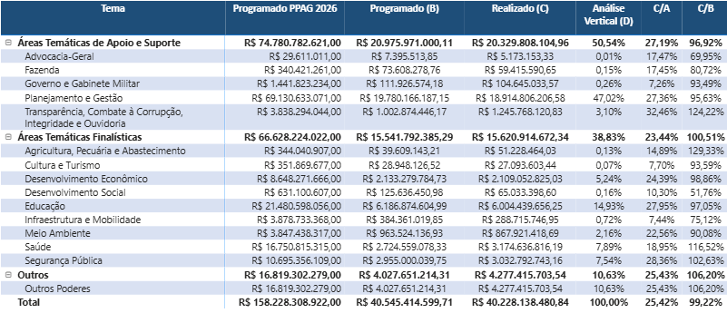

As Áreas Temáticas de Apoio e Suporte concentram a maior parte do orçamento estadual programado para 2026, totalizando R\$ 74.780.782.621,00. Por sua vez, o valor total programado nas Áreas Temáticas Finalísticas foi de R\$ 66.628.224.022,00 para 2026. Já os R\$ 16.819.302.279,00 alocados na área denominada Outros, indicam o valor total programado em ações que não se encaixam nas diretrizes estratégicas vinculadas ao PMDI; tratando das ações pertencentes aos Outros Poderes do Estado de Minas Gerias, como Assembleia Legislativa, Tribunal de Justiça, Ministério Público etc.

A análise do valor programado para o período seguiu a lógica distributiva do orçamento anual. Ou seja, o valor programado no segundo bimestre nas Áreas Temáticas de Apoio e Suporte (R\$ 20.975.971.000,11) foi superior àquele programado nas Áreas Temáticas Finalísticas (R\$ 15.541.792.385,29) e também na Área denominada Outros Poderes (R\$ 4.027.651.214,31).

Já em relação à execução por Área Temática, destaca-se que aquelas com maior execução comparada aos recursos programados para o período foram: Agricultura, Pecuária e Abastecimento (129,33%), Transparência, Combate à Corrupção, Integridade e Ouvidoria (124,22%), Saúde (116,52%), Outros Poderes (106,20%) e Segurança Pública (102,63%). Por sua vez, considerando apenas os valores realizados nas Áreas Temáticas, aquelas com maior participação na execução foram: Planejamento e Gestão (47,02%), Educação (14,93%), Outros Poderes (10,63%), Saúde (7,89%) e Segurança Pública (7,54%), os quais representam juntos 88,01% do total executado.

Por fim, as ações do PPAG podem ser também analisadas segundo suas Funções, isto é, conforme o maior nível de agregação das áreas de despesas que competem ao setor público, determinado pela Portaria Interministerial nº 42, de 14 de abril de 1999.

A seguir, a Tabela 4 apresenta a distribuição funcional da programação e execução da despesa no período monitorado:

Tabela 4 - Programação e execução dos programas por função - Minas Gerais - 2º bimestre de 2026

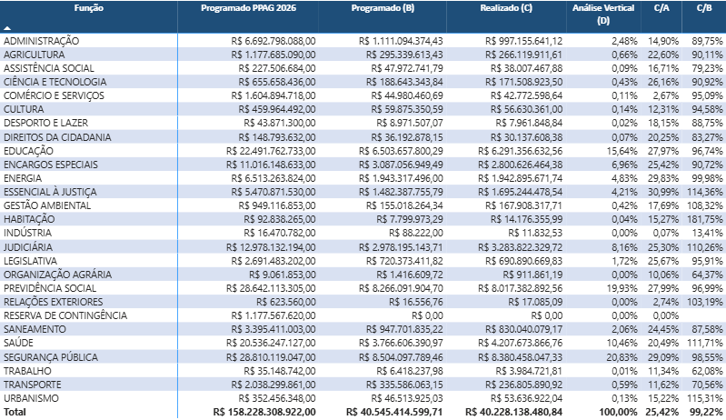

De acordo com os dados, é possível observar que as funções com maior participação relativa ao segundo bimestre foram: Segurança Pública (20,83%), Previdência Social (19,93%), Educação (15,64%), Saúde (10,46%), Judiciária (8,16%) e Encargos Especiais (6,96%). Por sua vez, as funções com maior execução comparada aos recursos programados no período foram: Habitação (181,75%), Urbanismo (115,31%), Essencial à Justiça (114,36%), Saúde (111,71%) e Judiciária (110,26%).

## 2.2 DESEMPENHO CONSOLIDADO DAS AÇÕES 

Nesta seção, o foco será a análise do desempenho das ações tomando como referência a execução física e orçamentária frente as metas programadas até o período monitorado.

A definição das metas físicas e orçamentárias é realizada durante a fase de elaboração do PPAG e de suas revisões, bem como na fase de elaboração da Lei Orçamentária Anual. Já a programação mensal das metas é realizada após a sanção da Lei do PPAG e de suas revisões, bem como da LOA. Esse detalhamento é de responsabilidade dos gestores das ações e é registrado no módulo de monitoramento do SIGPlan, viabilizando aferir o desempenho das ações, no que se refere ao alcance das metas estabelecidas no plano.

O Desempenho Consolidado da Ação oferece uma rápida visualização do desempenho físico e orçamentário até o bimestre monitorado, revelando, para cada uma dessas dimensões, se o status da ação é “sem meta estabelecida”, “sem execução”, “crítico”, “satisfatório” ou “subestimado”, conforme os seguintes parâmetros:

- *Status* satisfatório: dimensões física ou orçamentária do desempenho da ação caracterizadas por taxa de execução compreendida no intervalo entre 70% e 130% frente à meta programada até o período monitorado;

- *Status* crítico: dimensões física ou orçamentária do desempenho da ação caracterizadas por taxa de execução menor do que 70% da meta programada até o bimestre monitorado;

- *Status* subestimado: dimensões física ou orçamentária da ação caracterizadas por taxa de execução acima de 130% perante a meta programada até o último mês monitorado;

- *Status* sem execução: classificam-se nessa categoria as ações que possuem meta programada até o período analisado, mas que não a executaram até o momento. Seriam, portanto, aquelas ações que possuem desempenho igual a 0%;

- *Status* sem meta estabelecida: a ação não apresenta meta programada até o período avaliado, seja para a dimensão física ou orçamentária.

Importante destacar que, para o cálculo do desempenho da ação, foram consideradas todas as ações do PPAG 2024-2027, exercício 2026. Entretanto, para as ações que possuem execução de despesa de pessoal e auxílios e de outras despesas, essas despesas de pessoal e auxílios foram desconsideradas para a análise de desempenho. A exclusão dessas despesas na metodologia é feita com o objetivo de limitar o enviesamento da análise, visto que as despesas de pessoal e auxílios são sempre executadas.

Nesse sentido, o desempenho físico e orçamentário consolidado das ações, segundo intervalos de desempenho físico e orçamentário é demonstrado na Tabela 5:

Tabela 5 - Ações válidas de todos os programas do PPAG segundo intervalos de desempenho físico e orçamentário - Minas Gerais - 3º bimestre de 2026

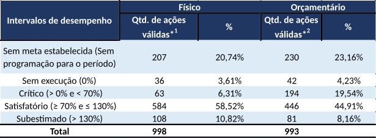**Fonte:** Sistema de Informações Gerenciais e de Planejamento (SIGPlan).

**Elaboração:** Superintendência Central de Planejamento e Orçamento (SCPO).

\*1 Para o desempenho físico, do total de 1007 ações, 997 foram consideradas válidas.

\*2 Para o cálculo do desempenho orçamentário, do total de 1007 ações, 993 foram consideradas válidas.

Inicialmente, é necessário esclarecer que as ações com desempenho inválido são aquelas classificadas como "não orçamentárias", ações transpostas ou ações criadas mediante crédito especial ou crédito extraordinário. As ações “não orçamentárias” possuem apenas metas físicas, não sendo possível a análise do desempenho orçamentário. As ações transpostas, criadas por crédito especial ou por crédito extraordinário, não foram previstas inicialmente na LOA, mas sim institucionalizadas após a sua sanção. Atualmente, existem 5 ações não orçamentárias e 9 ações transpostas ou institucionalizada por crédito especial ou crédito extraordinário.

Da análise dos dados da Tabela 5, verifica-se a maior representatividade das ações no intervalo “Satisfatório”, para o desempenho físico, representando 58,52% do total de ações consideradas válidas. Para o desempenho orçamentário verifica-se a maior representatividade das ações no intervalo “Satisfatório”, representando 44,91% do total de ações. Em seguida, tem-se as ações que não tiveram programação para o período analisado, sendo 20,74% para o desempenho orçamentário e 23,16% para o desempenho físico.

Excluindo-se as ações sem metas estabelecidas e analisando somente as ações com programação para o período, os dados também podem ser visualizados no Gráfico 1. Nesse contexto, observa-se a maior representatividade do intervalo “Satisfatório” na dimensão física (73,83%), e, de mesmo modo, a maior representatividade do intervalo “Satisfatório” na dimensão orçamentária (58,45%).

Gráfico 1 - Porcentagem de ações com programação para o período segundo intervalos de desempenho físico e orçamentário - Minas Gerais - 3º bimestre de 2026

> 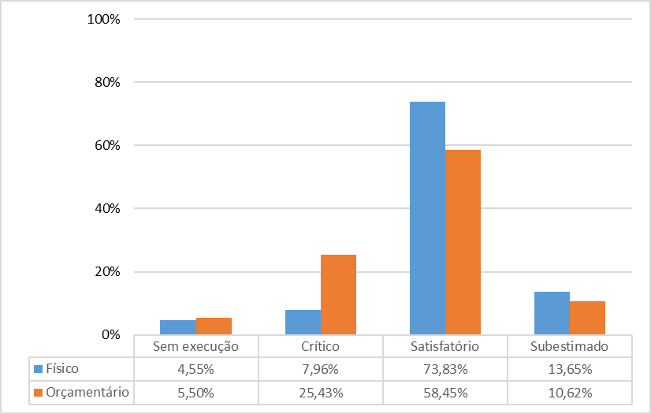

|                                                                              |
|------------------------------------------------------------------------------|
| **Fonte:** Sistema de Informações Gerenciais e de Planejamento (SIGPlan).    |
| **Elaboração:** Superintendência Central de Planejamento e Orçamento (SCPO). |

Por sua vez, o desempenho físico e orçamentário consolidado das ações também pode ser analisado a partir do tipo de acompanhamento, conforme demonstrado na Tabela 6:

**Tabela 6** - Ações válidas de todos os programas do PPAG segundo intervalos de desempenho e IAG (Identificador de Ação Governamental) - Minas Gerais - 3º bimestre de 2026

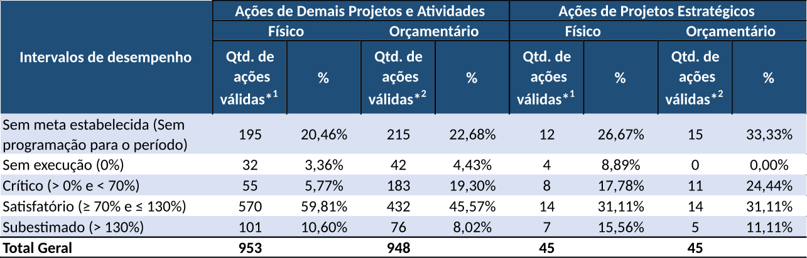

**Fonte:** Sistema de Informações Gerenciais e de Planejamento (SIGPlan).

**Elaboração:** Superintendência Central de Planejamento e Orçamento (SCPO).

\*1 Para o desempenho físico, do total de 1007 ações, 997 foram consideradas válidas.

\*2 Para o cálculo do desempenho orçamentário, do total de 1007 ações, 993 foram consideradas válidas.

Os dados acima demonstram a polarização do intervalo de desempenho preponderante para os Demais Projetos e Atividades, sendo 59,81% do desempenho físico como “Satisfatório” e 45,57% do desempenho orçamentário como “Satisfatório”. Por sua vez, destaca-se a preponderância dos projetos estratégicos no intervalo “Satisfatório” para o desempenho físico, 31,11%, e, para o desempenho orçamentário, as ações sem meta estabelecida para o período, 33,33%.

Considerando somente as ações com programação para o período, os dados podem ser visualizados no Gráfico 2:

Gráfico 2 - Percentual de ações de acompanhamento geral e intensivo, com programação para o período, segundo intervalos de desempenho físico e orçamentário - Minas Gerais - 3º bimestre de 2026

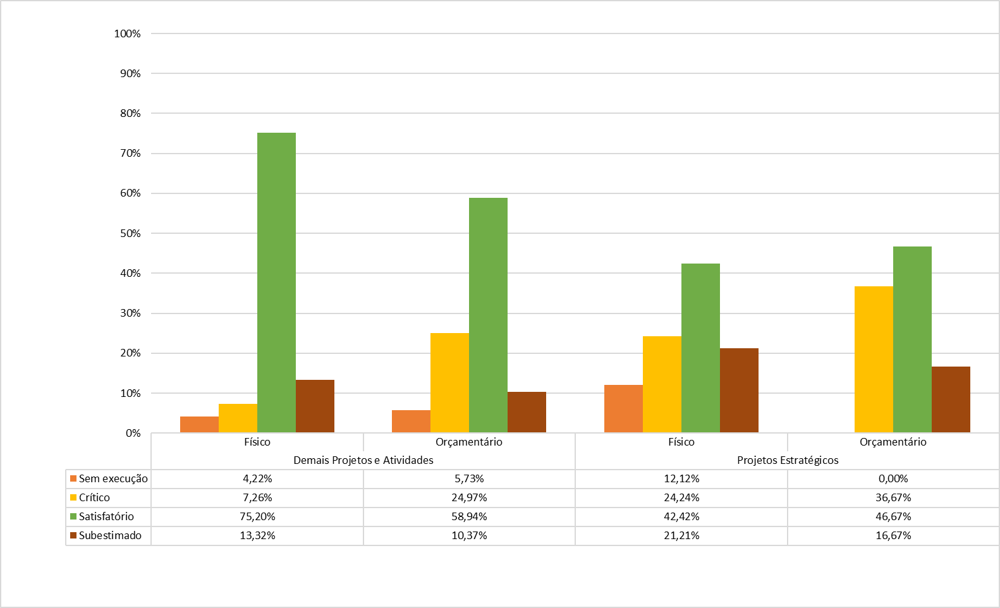

|                                                                              |
|------------------------------------------------------------------------------|
| **Fonte:** Sistema de Informações Gerenciais e de Planejamento (SIGPlan).    |
| **Elaboração:** Superintendência Central de Planejamento e Orçamento (SCPO). |

Analisando o desempenho físico e orçamentário das ações com meta programada para o período, verifica-se a preponderância do intervalo “Satisfatório”, para as ações de Demais Projetos e Atividades referente ao âmbito Físico (75,20%). Já em relação ao aspecto Orçamentário observou preponderância do intervalo “Satisfatório” (58,94%). Situação que se repete nos Projetos Estratégicos com a preponderância do intervalo “Satisfatório” no âmbito Físico (42,42%), e a preponderância do intervalo “Satisfatório” (46,67%) no aspecto Orçamentário.

## 2.3 REGIONALIZAÇÃO DOS PROGRAMAS 

Nesta seção será abordada a regionalização dos valores programados e executados nas ações do Plano até o período monitorado.

O PPAG 2024-2027 utilizou como critério de regionalização as Regiões Geográficas Intermediárias, que foram adotadas pelo Instituto Brasileiro de Geografia e Estatística – IBGE, em 2017. Com essa nova metodologia, retratada no Mapa 1, o Estado de Minas Gerais passa a ser dividido em 13 regiões, quais sejam:

1.  Região Intermediária de Barbacena;

2.  Região Intermediária de Belo Horizonte;

3.  Região Intermediária de Divinópolis;

4.  Região Intermediária de Governador Valadares;

5.  Região Intermediária de Ipatinga;

6.  Região Intermediária de Juiz de Fora;

7.  Região Intermediária de Montes Claros;

8.  Região Intermediária de Patos de Minas;

9.  Região Intermediária de Pouso Alegre;

10. Região Intermediária de Teófilo Otoni;

11. Região Intermediária de Uberaba;

12. Região Intermediária de Uberlândia;

13. Região Intermediária de Varginha.

Mapa 1 - Regiões Geográficas Intermediárias de Minas Gerais – IBGE

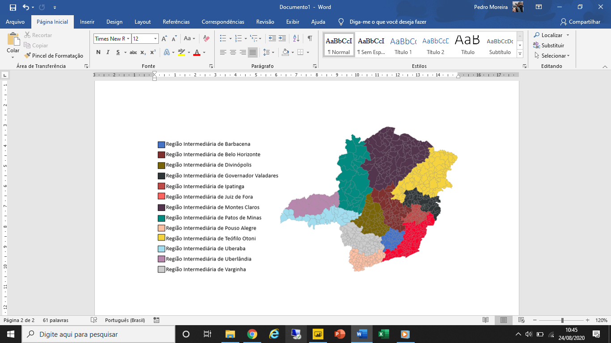

Fonte: Dados da Superintendência Central de Planejamento e Orçamento - SCPO/SEPLAG-MG e Instituto Brasileiro de Geografia e Estatística - IBGE

Nesse sentido, o termo regionalização passa a ser usado para se referir à distribuição da programação e execução das metas físicas e orçamentárias contidas nos programas e ações governamentais nos municípios estaduais entre as 13 regiões, em substituição à divisão por territórios adotada durante a vigência do PPAG 2024-2027.

Salienta-se que é possível a existência de programas governamentais cuja entrega/valor/benefício gerado contemplará, de forma indivisível, uma ou mais regiões ou o estado de Minas Gerais como um todo. Para tais casos não há que se falar em municipalização das metas. Sendo assim, a alocação espacial da programação e execução das metas físicas e orçamentárias contidas no PPAG ocorrerá de três maneiras distintas:

- Municipal;

- Regional;

- Estadual.

Destaca-se, ainda, que para viabilizar a análise sobre a regionalização das ações, os valores programados ou executados no localizador “Diversos Municípios – Estadual” foram incorporados às Regiões Intermediárias, proporcionalmente às respectivas populações.

Na Tabela 7, é possível visualizar os dados consolidados da programação e execução global desses programas, por região.

**Tabela 7** - Valor global programado e executado nos programas por Região Geográfica Intermediária - Minas Gerais - 2° bimestre de 2026

R\$1,00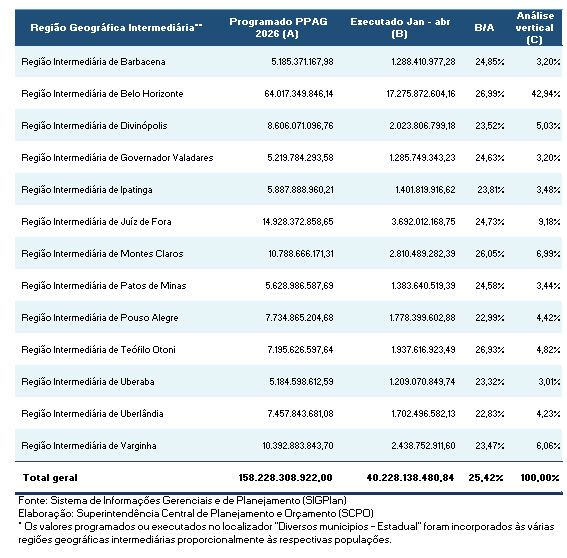

Conforme a tabela acima, as regiões que apresentaram maior participação na execução das ações dos programas do PPAG, no segundo bimestre de 2026, foram: Região Intermediária de Belo Horizonte (42,94%), Juiz de Fora (9,18%) e Montes Claros (6,99%), totalizando uma execução de 59,11%.

Considerando, por outro lado, a correlação entre os dispêndios programados e executados, as regiões que apresentaram as maiores taxas foram: a Região Intermediária de Belo Horizonte (26,99%), Teófilo Otoni (26,93%), Montes Claros (26,05%) e Barbacena (24,85%)

Para melhor visualização dos dados, utilizou-se o mapa do estado de Minas Gerais com os valores do gasto global programado de 2026 e a execução financeira do 2° bimestre, alocados por Região Geográfica Intermediária.

**Mapa 2 -** Gasto Global Programado por Região Geográfica Intermediária – Minas Gerais – 2026

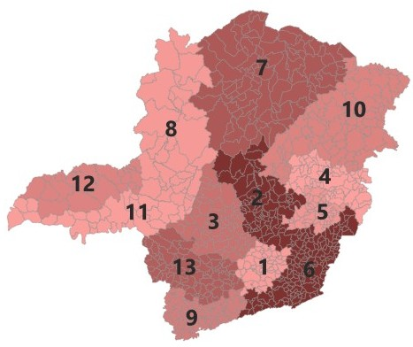

Fonte: Dados da Superintendência Central de Planejamento e Orçamento - SEPLAG-MG e Instituto Brasileiro de Geografia e Estatística - IBGE

**Mapa 3 -** Gasto Global Executado por Região Geográfica Intermediária –Minas Gerais – 2° Bimestre 2026

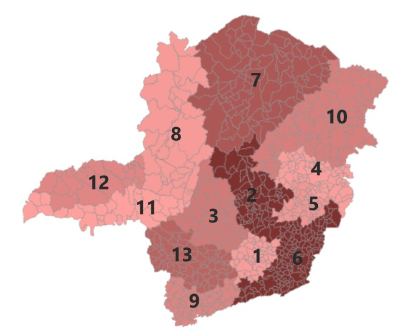

Fonte: Dados da Superintendência Central de Planejamento e Orçamento - SEPLAG-MG e Instituto Brasileiro de Geografia e Estatística - IBGE

**Legenda**

<table>
<colgroup>
<col style="width: 50%" />
<col style="width: 50%" />
</colgroup>
<tbody>
<tr class="odd">
<td><ol type="1">
<li>
Região Intermediária de Barbacena
</li>
</ol></td>
<td>8. Região Intermediária de Patos de Minas</td>
</tr>
<tr class="even">
<td><ol start="2" type="1">
<li>
Região Intermediária de Belo Horizonte
</li>
</ol></td>
<td>9. Região Intermediária de Pouso Alegre</td>
</tr>
<tr class="odd">
<td><ol start="3" type="1">
<li>
Região Intermediária de Divinópolis
</li>
</ol></td>
<td>10. Região Intermediária de Teófilo Otoni</td>
</tr>
<tr class="even">
<td><ol start="4" type="1">
<li>
Região Intermediária de Governador Valadares
</li>
</ol></td>
<td>11. Região Intermediária de Uberaba</td>
</tr>
<tr class="odd">
<td><ol start="5" type="1">
<li>
Região Intermediária de Ipatinga
</li>
</ol></td>
<td>12. Região Intermediária de Uberlândia</td>
</tr>
<tr class="even">
<td><ol start="6" type="1">
<li>
Região Intermediária de Juiz de Fora
</li>
</ol></td>
<td>13. Região Intermediária de Varginha</td>
</tr>
<tr class="odd">
<td><ol start="7" type="1">
<li>
Região Intermediária de Montes Claros
</li>
</ol></td>
<td></td>
</tr>
</tbody>
</table>

Nos Mapas apresentados acima, a intensidade das cores utilizadas relaciona-se ao grau de proximidade da programação e execução em relação à média regional estadual.

Assim, no mapa 2, as regiões com coloração mais escura são aquelas que detiveram o valor global programado superior a R\$ 12.171.408.378,62 que é a média geral das regiões. Seguindo a mesma lógica, no mapa 3, que se refere ao valor global executado, as mais escuras são aquelas que apresentaram valores superiores a R\$ 3.094.472.190,83.

As regiões de cor mais clara, diz respeito às localidades que estão entre o valor mínimo e a média. No caso do mapa 2 (gastos programados), o valor mínimo foi R\$ 5.184.598.612,59 referente à Região Intermediária de Uberaba e no mapa 3 (gastos executados), na mesma linha de raciocínio, o valor mínimo foi de R\$ 1.209.070.849,74 também na Região Intermediária de Uberaba.

Ressalta-se que a Região Intermediária que denotou os maiores valores de Gasto Global, tanto programado quanto executado, foi a de Belo Horizonte, sendo R\$ 64.017.349.846,14 (programado – mapa 2) e R\$ 17.275.872.604,16 (executado - mapa 3).

Por fim, apresenta-se na tabela 8 a distribuição per capita dos valores programados e executados por regiões intermediárias no 2° bimestre de 2026. O objetivo é evidenciar a proporcionalização dos gastos em relação ao quantitativo populacional das regiões.

Verifica-se que, no período de janeiro a abril de 2026, as regiões que apresentaram maior gasto per capita foram: Região Intermediária de Belo Horizonte (R\$ 2.729,53), Governador Valadares (R\$ 1.740,19) e Montes Claros (R\$ 1.692,15).

Tabela 8 - Gasto per capita\* programado e executado nos programas por Região Geográfica Intermediária - Minas Gerais - 2° bimestre de 2026

R\$1,00

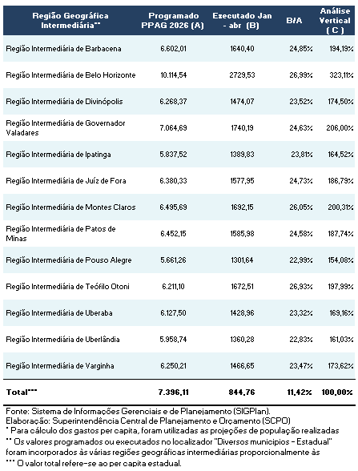

Analogamente, o gasto global programado e executado *per capita* pode também ser visualizado nos mapas abaixo:

Mapa 4 - Gasto Global Programado *Per Capita* por Região Geográfica Intermediária – Minas Gerais – 2026

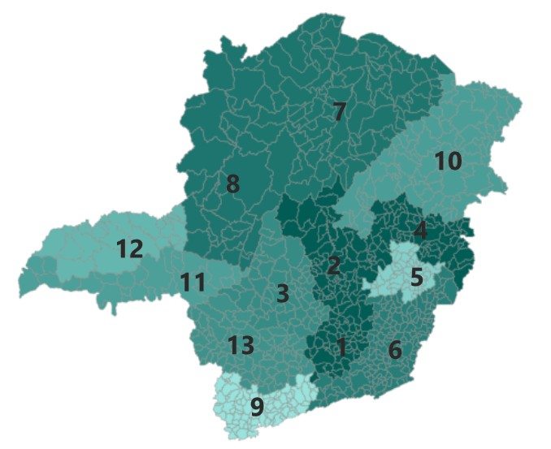

Fonte: Dados da Superintendência Central de Planejamento e Orçamento - SEPLAG-MG e Instituto Brasileiro de Geografia e Estatística – IBGE

Mapa 5 - Gasto Global Executado *Per Capita* por Região Geográfica Intermediária – Minas Gerais – 2° Bimestre 2026

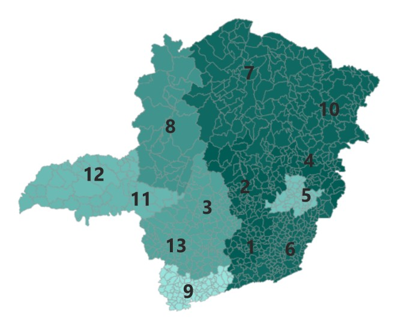

Fonte: Dados da Superintendência Central de Planejamento e Orçamento - SEPLAG-MG e Instituto Brasileiro de Geografia e Estatística - IBGE

**Legenda**

<table>
<colgroup>
<col style="width: 50%" />
<col style="width: 50%" />
</colgroup>
<tbody>
<tr class="odd">
<td><ol type="1">
<li>
Região Intermediária de Barbacena
</li>
</ol></td>
<td>8. Região Intermediária de Patos de Minas</td>
</tr>
<tr class="even">
<td><ol start="2" type="1">
<li>
Região Intermediária de Belo Horizonte
</li>
</ol></td>
<td>9. Região Intermediária de Pouso Alegre</td>
</tr>
<tr class="odd">
<td><ol start="3" type="1">
<li>
Região Intermediária de Divinópolis
</li>
</ol></td>
<td>10. Região Intermediária de Teófilo Otoni</td>
</tr>
<tr class="even">
<td><ol start="4" type="1">
<li>
Região Intermediária de Governador Valadares
</li>
</ol></td>
<td>11. Região Intermediária de Uberaba</td>
</tr>
<tr class="odd">
<td><ol start="5" type="1">
<li>
Região Intermediária de Ipatinga
</li>
</ol></td>
<td>12. Região Intermediária de Uberlândia</td>
</tr>
<tr class="even">
<td><ol start="6" type="1">
<li>
Região Intermediária de Juiz de Fora
</li>
</ol></td>
<td>13. Região Intermediária de Varginha</td>
</tr>
<tr class="odd">
<td><ol start="7" type="1">
<li>
Região Intermediária de Montes Claros
</li>
</ol></td>
<td></td>
</tr>
</tbody>
</table>

Assim como nos mapas de Gasto Global Programado Geral e de Gasto Global Executado Geral, anteriormente analisados, os mapas de Gasto Global Programado e Executado *per capita* seguem a mesma lógica. Portanto, a intensidade das cores usadas, refere-se ao grau de proximidade da execução em relação à média regional estadual.

Logo, no mapa 4, as regiões com coloração mais escura foram aquelas que detiveram o valor global programado superior a R\$ 6.571,09 que se trata da média geral das regiões. Da mesma forma, no mapa 5, que se refere ao valor global executado, são aquelas que apresentaram valores superiores a R\$ 1620,01

As regiões de coloração mais clara, dizem respeito às localidades que estão entre o valor mínimo e a média. No caso do mapa 4 (gastos programados), o valor mínimo foi R\$ 5.661,26 referente à Região Intermediária de Pouso Alegre, e no mapa 5 (gastos executados), equivale à R\$ 1.301,64 – também referente a Região Intermediária de Pouso Alegre.

Por fim, a Região Intermediária que denotou os maiores valores de Gasto Global, tanto programado quanto executado per capita, foi de Belo Horizonte, em ambos os casos, R\$ 10.114,54 (programado – mapa 4) e R\$ 2.279,53 (executado - mapa 5).

## 2.4 EXECUÇÃO ORÇAMENTÁRIA NOS MUNICÍPIOS CLASSIFICADOS NO EXTRATO IDENTIFICADO COMO DE BAIXO DESEMPENHO DO IMRS

O Índice Mineiro de Responsabilidade Social - IMRS[^1] divulga o perfil de desempenho dos municípios do Estado nas áreas sociais. De acordo com a Lei nº 14.172 de 15/01/2002, o Índice considera as dimensões de assistência social, educação, saúde, emprego, segurança alimentar, segurança pública, habitação, saneamento, transporte, lazer e renda, consoante as variáveis de gênero, etnia, orientação sexual, idade, condição de deficiência, esforço de gestão governamental e participação popular.

A fim de aferir o desempenho dos municípios classificados nas 50 piores posições do IMRS durante o exercício corrente, bem como evidenciar as informações necessárias ao controle da eficácia das ações voltadas para o desenvolvimento social dos municípios com pior desempenho nesse índice, a seção que se segue contém os seguintes demonstrativos:

- Demonstrativo dos Recursos Programados e Aplicados, por Programa, no Desenvolvimento Social dos Municípios Classificados nas Cinquenta Últimas Posições do IMRS;

- Demonstrativo dos Recursos Aplicados no Desenvolvimento Social dos Municípios Classificados nas Cinquenta Últimas Posições do IMRS por Áreas Temáticas

- Demonstrativo dos Recursos Programados e Aplicados nos Municípios Classificados nas Cinquenta Últimas Posições do IMRS.

Os demonstrativos retratarão, além dos recursos aplicados até o bimestre monitorado, o valor programado inicial em cada programa e município. O objetivo é evidenciar o desempenho da política frente ao planejamento.

Na tabela abaixo se encontram os valores programados e executados nos programas do PPAG, que contemplaram os municípios classificados nas 50 piores posições do IMRS.

**  
**

**Tabela 9 -** Demonstrativo dos Recursos Programados e Aplicados, por Programa, no Desenvolvimento Social dos Municípios Classificados nas Cinquenta Últimas Posições do IMRS – Minas Gerais - 3º bimestre de 2026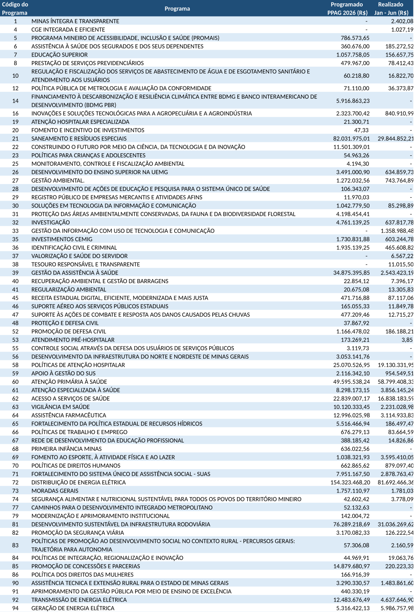

(Continua)

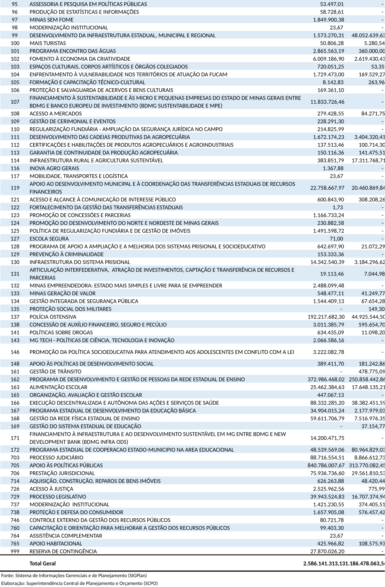

(Conclusão)

Ressalta-se que os programas indicados na tabela com valor programado igual a zero não possuíam valores planejados para o desenvolvimento dos municípios classificados nas cinquenta piores posições do IMRS. Entretanto, como é sabido, o planejamento não é estático e seu ciclo de funcionamento pressupõe a possibilidade de mudança de escopo, redefinição de metas e adequação da execução. Logo, ocorreu no decorrer do exercício a execução de despesas nesses municípios. Para esses casos a comparação entre o valor programado e o executado ficará prejudicada.

Por sua vez, a tabela 10 apresenta os dados relacionados ao IMRS por Área Temática:

Tabela 10 - Demonstrativo dos Recursos Aplicados no Desenvolvimento Social dos Municípios Classificados nas Cinquenta Últimas Posições do IMRS – 3º bimestre de 2026 - Áreas Temáticas

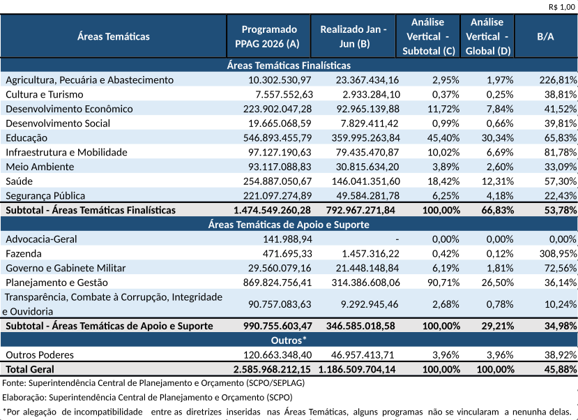

A maioria dos recursos programados nos municípios que ocupam as 50 últimas posições do IMRS concentrou-se nas Áreas Temáticas Finalísticas, representando 57,02% do valor total programado (R\$ 2.585.968.212,15). Já as Áreas de Apoio e Suporte representaram 38,31%, ou seja, R\$ 990.755.603,47 do montante total programado. Por sua vez, o valor total programado nos Outros Poderes foi de apenas 4,67% - R\$ 120.663.348,40 - do valor total programado nesses municípios. De modo geral, observa-se que as Áreas com maior valor programado foram: Planejamento e Gestão (R\$ 869.824.756,41 ou 33,64% do valor total programado), Educação (R\$ 546.893.455,79 ou 21,15% do valor total programado), Saúde (R\$ 254.887.050,67 ou 9,86%) e Segurança Pública (R\$ 221.097.274,89 ou 8,55%).

Analisando-se a execução do período, se observa a tendência global de concentração dos gastos nas Áreas Temáticas Finalísticas. Do total realizado no período, 66,83% (R\$ 792.967.271,84) foi registrado nas Áreas Finalísticas, com destaque para a Área de Educação que representou 45,40% desse total. Quando se observa o valor executado frente ao valor planejado por área, constata-se que a Agricultura, Pecuária e Abastecimento obteve o maior percentual, tendo em vista que foram executados 226,81% em relação aos recursos planejados. Apesar da grande variação, ainda é uma área temática que concentra apenas 1,97% da execução total até junho.

Por fim, a tabela 11 evidencia os recursos planejados e aplicados nos municípios classificados nas cinquenta piores posições do IMRS:

**Tabela 11** - Demonstrativo dos Recursos Programados e Aplicados nos Municípios Classificados nas Cinquenta Últimas Posições do IMRS – Minas Gerais - 3º bimestre de 2026

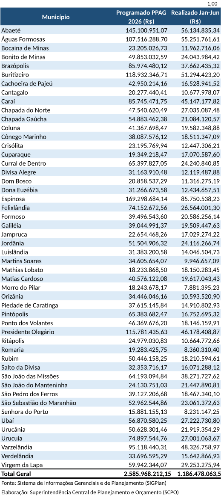

De modo a facilitar a visualização dos dados apresentados acima, os mapas 6 e 7 também trazem informações acerca do valor programado e executado dos municípios classificados nas cinquenta últimas posições do IMRS. O grau de intensidade das cores leva em consideração a proximidade ou distanciamento dos valores alocados nesses municípios em relação à média estadual.

**Mapa 6 –** Valor Global Programado nos Municípios Classificados nas Cinquenta Piores Posições do IMRS – Minas Gerais – 2026

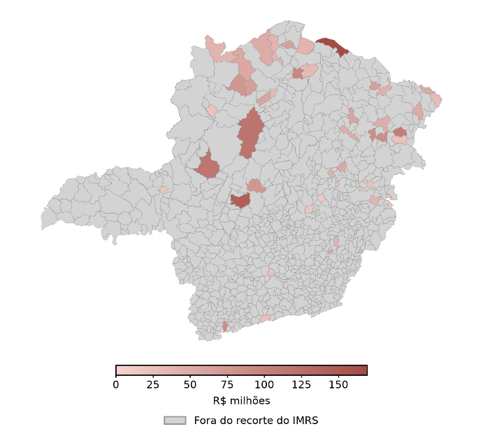

Fonte: Sistema de Informações Gerenciais e de Planejamento (SIGPlan) e Instituto Brasileiro de Geografia e Estatística (IBGE).

Elaboração: Superintendência Central de Planejamento e Orçamento (SCPO).

Mapa 7 - Valor Global Executado nos Municípios Classificados nas Cinquenta Últimas Posições do IMRS – Minas Gerais – 3° Bimestre de 2026

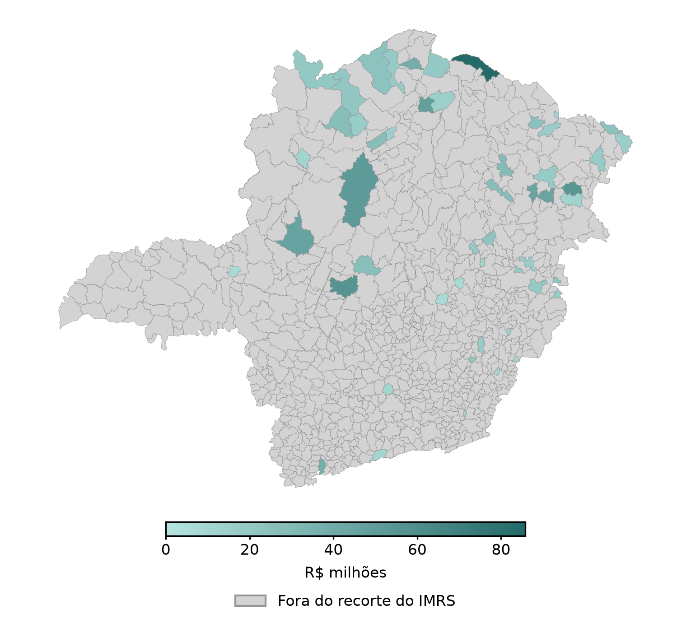

Fonte: Sistema de Informações Gerenciais e de Planejamento (SIGPlan) e Instituto Brasileiro de Geografia e Estatística (IBGE).

Elaboração: Superintendência Central de Planejamento e Orçamento (SCPO).

Analisando-se o mapa 6, as localidades com coloração mais escura são aquelas cujo valor global programado para 2026 está bem próximo ou ultrapassa a média estadual, que é de aproximadamente R\$ R\$ 185.496.258,99). Nesse aspecto, constata-se que o município de Espinosa R\$ 169.298.684,14 foi o que mais se aproximou a ela.

Por sua vez, o Mapa 7 evidencia o valor executado acumulado até o 3º bimestre de 2026, considerando a média estadual por município de R\$ 79.425.189,42. Entre os municípios classificados nas cinquenta últimas posições do IMRS, apenas Espinosa (R\$ 85.750.538,23) ultrapassou esse valor. Entre os municípios que permaneceram abaixo da média, Abaeté (R\$ 56.134.835,34) e Águas Formosas (R\$ 55.251.761,61) foram os que mais se aproximaram desse patamar.

## 2.5 DETALHAMENTO DA EXECUÇÃO DA DESPESA DE PESSOAL E AUXÍLIOS 

A partir do PPAG 2024-2027, exercício 2026, a metodologia de elaboração de programas e ações com foco nas políticas públicas foi continuada, entretanto, as despesas com pessoal e auxílios foram alocadas, na sua grande maioria, em uma única ação padronizada. Assim, salvo exceções, as Unidades Orçamentárias criaram uma ação 2417 – “Remuneração de Pessoal Ativo e Encargos Sociais”, sob sua responsabilidade, dentro do programa 705 – “Apoio às Políticas Públicas”, sob responsabilidade da Secretaria de Estado de Planejamento e Gestão – SEPLAG, para concentrar sua despesa de pessoal e auxílios.

Importante ponderaram que algumas Unidades Orçamentárias não possuem a ação 2417, tendo suas despesas de pessoal e auxílio alocadas em demais ações, sendo essas: Polícia Militar de Minas Gerais (PMMG), EGE-SEPLAG, Secretaria de Estado de Educação (SEE), Corpo de Bombeiros Militar do Estado de Mias Gerais (CBMMG), Fundação Helena Antipoff (FHA), Instituto de Desenvolvimento do Norte e Nordeste de Minas Gerais (IDENE), Empresa Mineira de Comunicação (EMC) e Fundo Financeiro de Previdência (FUNFIP).

Ainda, existem Unidades Orçamentárias que, além da ação padronizada 2417 também possuem outras ações para pagamento de pessoal, como: Secretaria de Estado de Agricultura, Pecuária e Abastecimento de Minas Gerais (SEAPA), Secretaria de Estado de Justiça e Segurança Pública (SEJUSP), Secretaria de Estado de Desenvolvimento Social (SEDESE), Secretaria de Estado de Planejamento e Gestão de Minas Gerais (SEPLAG), Polícia Civil de Minas Gerais (PCMG), Fundação João Pinheiro (FJP), Instituto de Previdência dos Servidores Militares do Estado de Minas Gerais (IPSM), Fundação Educacional Caio Martins (FUCAM), Fundação Clóvis Salgado (FCS), Empresa de Pesquisa Agropecuária de Minas Gerais (EPAMIG).

Para fins de análise e segregação das ações, entende-se por despesa de pessoal e auxílios a programação e execução das despesas no Grupo de Despesa 1 (Pessoal e Encargos Sociais), com exceção do IPU 9 (Recursos Recebidos para Precatórios e Sentenças Judiciais); em todos os itens do elemento 34 (Outras Despesas Decorrentes de Contratos de Terceirização) e no IPU 7 (Recursos Recebidos para Auxílios).

Apesar da alteração da alocação das despesas de pessoal e auxílios, a transparência a respeito ao orçamento aplicado na implementação e manutenção da política pública foi mantida, uma vez que é possível identificar e acompanhar a previsão e a execução dessas despesas dentro de cada unidade orçamentária.

Evidencia-se a partir da Tabela 12 os dados de programação e execução das despesas de pessoal e auxílio de acordo com o setor de governo:

**Tabela 12 -** Programação e Execução da Despesa de Pessoal e Auxílios por Setor de Governo - Minas Gerais - 3º bimestre de 2026

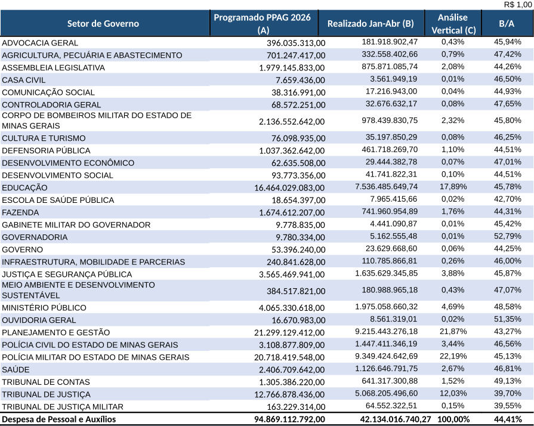

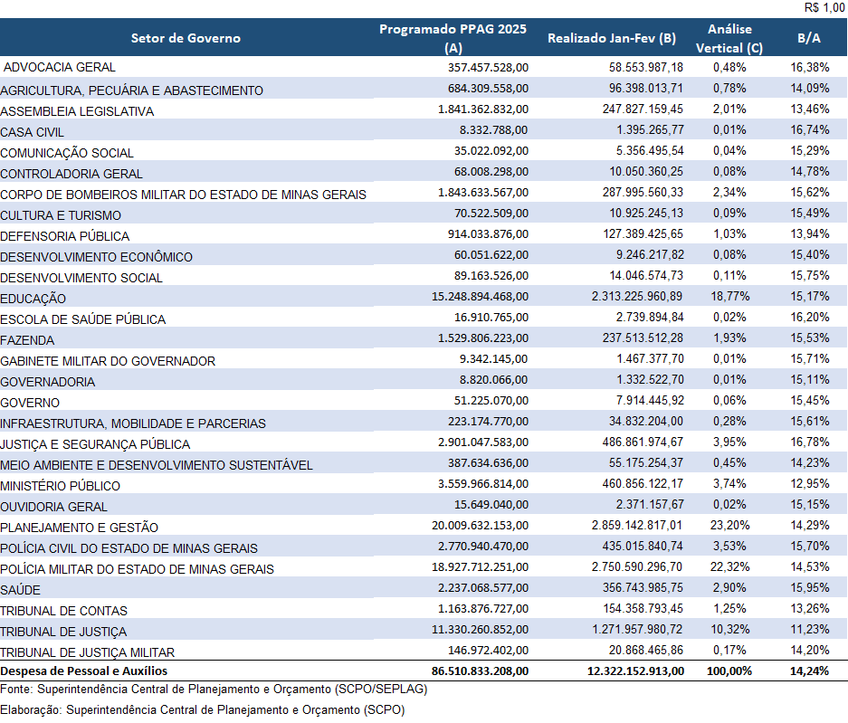

Os setores de governo reúnem órgãos, secretarias de estado e entidades subordinadas por vinculação (autarquias, fundações, empresas dependentes e empresas controladas), que desempenham atividades relacionadas a determinado campo de interesse público. Destaca-se que os órgãos autônomos são independentes e não apresentam vínculo de subordinação com outro órgão. Sendo assim, inserem-se em setores próprios.

Os setores com maior execução de Pessoal e Auxílios até o primeiro bimestre foram: Polícia Militar do Estado de Minas do Estado de Minas Gerais (22,19%), Planejamento de Gestão (21,89%), Educação (17,89%), e Tribunal de Justiça (12,03%).

Já no comparativo dos valores programados em 2026 e executados até o período analisado, os setores com maior percentual de execução foram: Governadoria (52,79%), Ouvidoria Geral (51,35%), Tribunal de Contas (49,13%) e Ministério Público (48,58%).

# **DEMONSTRATIVO DO DESEMPENHO FÍSICO‐ORÇAMENTÁRIO DO PPAG**

[^1]: MINAS GERAIS. Índice Mineiro de Responsabilidade Social. Disponível em: <u><http://imrs.fjp.mg.gov.br/></u>
