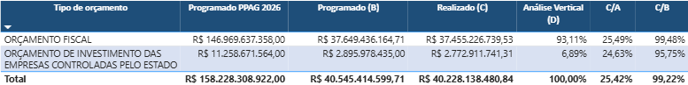
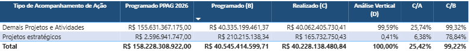
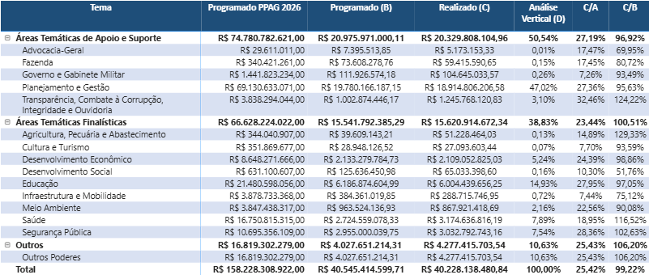
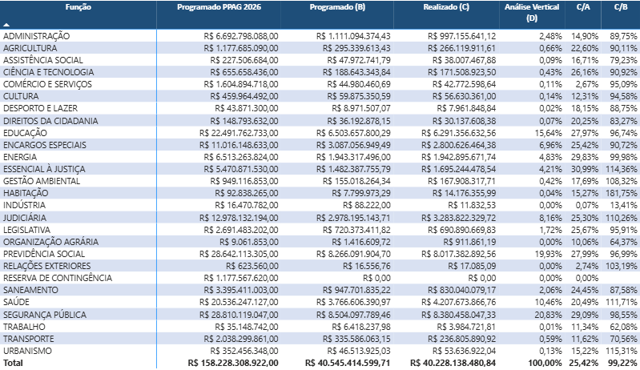

<!-- Trecho do RIM original; sem revisão numérica nem atualização de período. -->

## 2.1 EXECUÇÃO GLOBAL ATÉ O 2º BIMESTRE DE 2026

A análise bimestral da execução considera o valor total da despesa programada no PPAG, isto é, o valor integral a ser realizado pela ação durante o ano, e o correlaciona com o valor programado até o bimestre vigente, isto é, com o valor parcial planejado pela ação em função dos 6 bimestres anuais. Tais metas são fixadas pelos gestores de cada órgão durante a de elaboração ou a revisão do PPAG, sendo inseridas de forma técnica e procedimental no sistema de planejamento utilizado pelo Estado (SIGPlan).

Com o objetivo de evidenciar a natureza das informações, a análise consolidada da execução será segmentada nos seguintes estratos: I- tipo de orçamento, II- tipo de acompanhamento, III- áreas temáticas, IV- funções e V- regionalização. A explicação funcional de cada uma destas categorias será demonstrada abaixo e, em seguida, serão apresentados seus respectivos dados e as análises.

As ações que compõem o PPAG podem ser detalhadas levando em consideração um dos dois tipos de orçamento existentes:

> ● Orçamento fiscal, que abrange todas as despesas correntes (categoria 3) e de capital (categoria 4) referentes a todos os Poderes do Estado, os seus fundos, órgãos e entidades da administração direta e indireta - inclusive as fundações instituídas e mantidas pelo Poder Público, além das empresas estatais dependentes;
>
> ● Orçamento de investimento das empresas controladas pelo Estado, que compreende apenas despesas de investimento das empresas em que o governo mineiro, direta ou indiretamente, detenha maioria do capital social com direito a voto.

A seguir, a Tabela 1 apresenta os valores globais programados, de forma consolidada, bem como a execução por cada tipo de orçamento até o segundo bimestre de 2026:

Tabela 1 - Programação e execução dos programas por tipo de orçamento - Minas Gerais - 2º bimestre de 2026

A partir dos dados, constata-se a preponderância do orçamento fiscal em relação ao orçamento de investimento. No segundo bimestre de 2026, 93,11% dos recursos realizados pertenceram ao orçamento fiscal, enquanto apenas 6,89% foram alocados no orçamento de investimento. Além disso, é possível observar uma maior aderência da execução do orçamento fiscal em relação aos recursos programados para o período, haja vista que 99,48% dos recursos programados foram realizados, enquanto no orçamento de investimento essa relação atingiu 95,75%. Por fim, quando se verifica a análise global, é possível observar que houve a execução de 99,22% dos recursos orçamentários totais programados para o período.

Ademais, as ações do PPAG também podem ser analisadas levando em consideração o tipo de acompanhamento, isto é, considerando a metodologia adotada no seu monitoramento:

- Projetos Estratégicos: compreendem as ações prioritárias, compondo a linha fundamental de atuação do governo. Geralmente são ações com alto potencial de impacto e que, por isso, dispõem de um acompanhamento pormenorizado;

- Demais Projetos e Atividades: referem-se às ações que contemplam as prioridades setoriais de cada órgão, mas que não estão diretamente vinculadas à linha fundamental de atuação do governo. Em geral, essas ações englobam atividades com foco na manutenção e melhoria da própria máquina pública.

A seguir, a Tabela 2 apresenta a distribuição dos valores programados e realizados conforme o tipo de acompanhamento:

Tabela 2 -Programação e execução dos programas por tipo de acompanhamento de ação - Minas Gerais - 2º bimestre de 2026

A partir dos dados, constata-se que os Demais Projetos e Atividades executaram a maior fatia dos recursos, representando 99,59% do valor total executado, enquanto a realização dos Projetos Estratégicos representou apenas 0,41%. Isso ocorre pela distribuição das ações, em que, de um total de 1007, 45 são classificadas como Projetos Estratégicos e 962 são classificadas como Demais Projetos e Atividades. Apesar dessa concentração, é possível verificar que o tipo de acompanhamento não confere primazia às execuções orçamentárias, de modo que o percentual das despesas realizadas em função das despesas programadas é de 99,32% para as ações do tipo Demais Projetos e 78,84% para as do tipo Projetos Estratégicos.

Ademais, é possível analisar as ações do PPAG conforme suas respectivas áreas de atuação. O Plano Mineiro de Desenvolvimento Integrado (PMDI) determina – além da visão de futuro, objetivos estratégicos e diretrizes gerais que orientam as ações governamentais – aquilo que vem a ser as áreas temáticas atuação:

- Áreas Temáticas Finalísticas: são atribuídas às políticas que produzem resultados diretos para os cidadãos, sendo elas responsáveis por consolidar as transformações necessárias em vistas dos objetivos e princípios estratégicos definidos no PMDI. Tais políticas dirigem seus esforços em operações de transformação ou melhoria, a fim concretizar às metas de médio e longo prazo também estipuladas no PMDI;

- Áreas Temáticas de Apoio e Suporte: são atribuídas às políticas que fornecem todo o subsídio necessário às demais atividades finalísticas. Mesmo não entregando serviços diretos à população, elas são as responsáveis por possibilitar todas as políticas finalísticas, na medida em que subsidiam todas as suas operações, sendo o ponto de partida para o alcance de qualquer meta ou resultado.

Existem 14 áreas temáticas, sendo 9 delas definidas como áreas finalísticas e 5 delas definidas como áreas suporte:

- Áreas Temáticas Finalísticas: (1) Agricultura, Pecuária e Abastecimento; (2) Cultura e Turismo; (3) Desenvolvimento Econômico; (4) Desenvolvimento Social; (5) Educação; (6) Infraestrutura e Mobilidade; (7) Meio Ambiente; (8) Saúde; e (9) Segurança Pública;

- Áreas Temáticas de Apoio e Suporte: (10) Advocacia-Geral, (11) Fazenda, (12) Governo e Gabinete Militar, (13) Planejamento e Gestão e (14) Transparência, Combate à Corrupção, Integridade e Ouvidoria.

A seguir, a Tabela 3 demonstra a execução global a partir dessas Áreas:

Tabela 3 - Programação e execução dos programas por Área Temática - Minas Gerais - 2º bimestre de 2026

As Áreas Temáticas de Apoio e Suporte concentram a maior parte do orçamento estadual programado para 2026, totalizando R\$ 74.780.782.621,00. Por sua vez, o valor total programado nas Áreas Temáticas Finalísticas foi de R\$ 66.628.224.022,00 para 2026. Já os R\$ 16.819.302.279,00 alocados na área denominada Outros, indicam o valor total programado em ações que não se encaixam nas diretrizes estratégicas vinculadas ao PMDI; tratando das ações pertencentes aos Outros Poderes do Estado de Minas Gerias, como Assembleia Legislativa, Tribunal de Justiça, Ministério Público etc.

A análise do valor programado para o período seguiu a lógica distributiva do orçamento anual. Ou seja, o valor programado no segundo bimestre nas Áreas Temáticas de Apoio e Suporte (R\$ 20.975.971.000,11) foi superior àquele programado nas Áreas Temáticas Finalísticas (R\$ 15.541.792.385,29) e também na Área denominada Outros Poderes (R\$ 4.027.651.214,31).

Já em relação à execução por Área Temática, destaca-se que aquelas com maior execução comparada aos recursos programados para o período foram: Agricultura, Pecuária e Abastecimento (129,33%), Transparência, Combate à Corrupção, Integridade e Ouvidoria (124,22%), Saúde (116,52%), Outros Poderes (106,20%) e Segurança Pública (102,63%). Por sua vez, considerando apenas os valores realizados nas Áreas Temáticas, aquelas com maior participação na execução foram: Planejamento e Gestão (47,02%), Educação (14,93%), Outros Poderes (10,63%), Saúde (7,89%) e Segurança Pública (7,54%), os quais representam juntos 88,01% do total executado.

Por fim, as ações do PPAG podem ser também analisadas segundo suas Funções, isto é, conforme o maior nível de agregação das áreas de despesas que competem ao setor público, determinado pela Portaria Interministerial nº 42, de 14 de abril de 1999.

A seguir, a Tabela 4 apresenta a distribuição funcional da programação e execução da despesa no período monitorado:

Tabela 4 - Programação e execução dos programas por função - Minas Gerais - 2º bimestre de 2026

De acordo com os dados, é possível observar que as funções com maior participação relativa ao segundo bimestre foram: Segurança Pública (20,83%), Previdência Social (19,93%), Educação (15,64%), Saúde (10,46%), Judiciária (8,16%) e Encargos Especiais (6,96%). Por sua vez, as funções com maior execução comparada aos recursos programados no período foram: Habitação (181,75%), Urbanismo (115,31%), Essencial à Justiça (114,36%), Saúde (111,71%) e Judiciária (110,26%).

