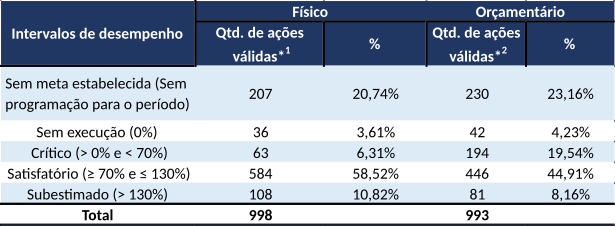
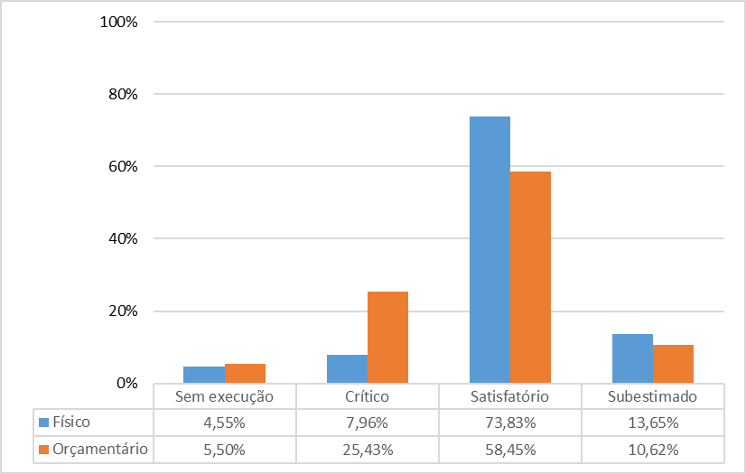
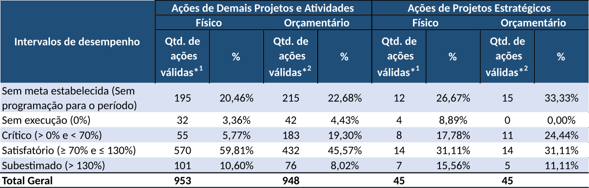
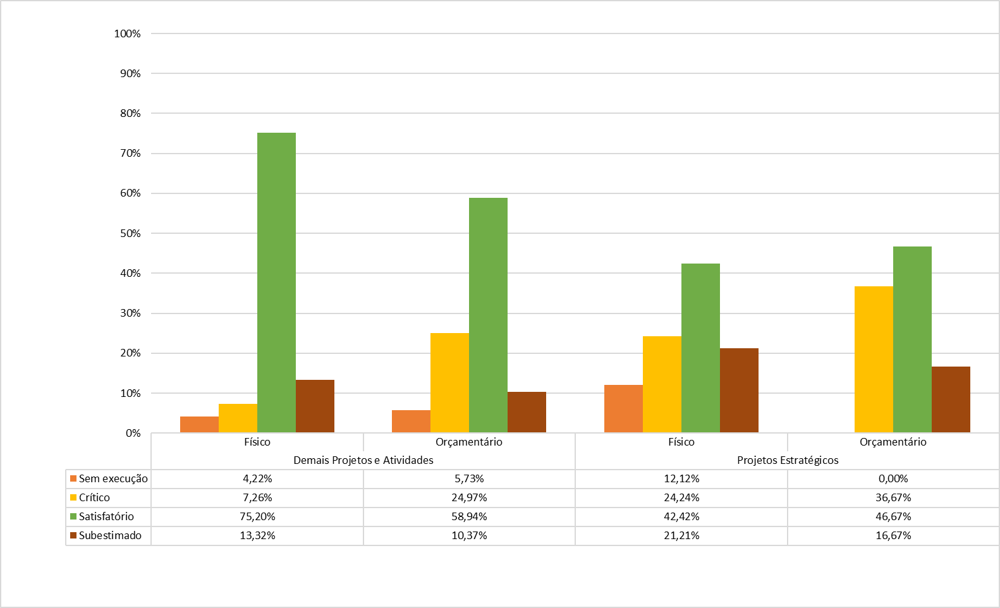

<!-- Trecho do RIM original; sem revisão numérica nem atualização de período. -->

## 2.2 DESEMPENHO CONSOLIDADO DAS AÇÕES 

Nesta seção, o foco será a análise do desempenho das ações tomando como referência a execução física e orçamentária frente as metas programadas até o período monitorado.

A definição das metas físicas e orçamentárias é realizada durante a fase de elaboração do PPAG e de suas revisões, bem como na fase de elaboração da Lei Orçamentária Anual. Já a programação mensal das metas é realizada após a sanção da Lei do PPAG e de suas revisões, bem como da LOA. Esse detalhamento é de responsabilidade dos gestores das ações e é registrado no módulo de monitoramento do SIGPlan, viabilizando aferir o desempenho das ações, no que se refere ao alcance das metas estabelecidas no plano.

O Desempenho Consolidado da Ação oferece uma rápida visualização do desempenho físico e orçamentário até o bimestre monitorado, revelando, para cada uma dessas dimensões, se o status da ação é “sem meta estabelecida”, “sem execução”, “crítico”, “satisfatório” ou “subestimado”, conforme os seguintes parâmetros:

- *Status* satisfatório: dimensões física ou orçamentária do desempenho da ação caracterizadas por taxa de execução compreendida no intervalo entre 70% e 130% frente à meta programada até o período monitorado;

- *Status* crítico: dimensões física ou orçamentária do desempenho da ação caracterizadas por taxa de execução menor do que 70% da meta programada até o bimestre monitorado;

- *Status* subestimado: dimensões física ou orçamentária da ação caracterizadas por taxa de execução acima de 130% perante a meta programada até o último mês monitorado;

- *Status* sem execução: classificam-se nessa categoria as ações que possuem meta programada até o período analisado, mas que não a executaram até o momento. Seriam, portanto, aquelas ações que possuem desempenho igual a 0%;

- *Status* sem meta estabelecida: a ação não apresenta meta programada até o período avaliado, seja para a dimensão física ou orçamentária.

Importante destacar que, para o cálculo do desempenho da ação, foram consideradas todas as ações do PPAG 2024-2027, exercício 2026. Entretanto, para as ações que possuem execução de despesa de pessoal e auxílios e de outras despesas, essas despesas de pessoal e auxílios foram desconsideradas para a análise de desempenho. A exclusão dessas despesas na metodologia é feita com o objetivo de limitar o enviesamento da análise, visto que as despesas de pessoal e auxílios são sempre executadas.

Nesse sentido, o desempenho físico e orçamentário consolidado das ações, segundo intervalos de desempenho físico e orçamentário é demonstrado na Tabela 5:

Tabela 5 - Ações válidas de todos os programas do PPAG segundo intervalos de desempenho físico e orçamentário - Minas Gerais - 3º bimestre de 2026

**Fonte:** Sistema de Informações Gerenciais e de Planejamento (SIGPlan).

**Elaboração:** Superintendência Central de Planejamento e Orçamento (SCPO).

\*1 Para o desempenho físico, do total de 1007 ações, 997 foram consideradas válidas.

\*2 Para o cálculo do desempenho orçamentário, do total de 1007 ações, 993 foram consideradas válidas.

Inicialmente, é necessário esclarecer que as ações com desempenho inválido são aquelas classificadas como "não orçamentárias", ações transpostas ou ações criadas mediante crédito especial ou crédito extraordinário. As ações “não orçamentárias” possuem apenas metas físicas, não sendo possível a análise do desempenho orçamentário. As ações transpostas, criadas por crédito especial ou por crédito extraordinário, não foram previstas inicialmente na LOA, mas sim institucionalizadas após a sua sanção. Atualmente, existem 5 ações não orçamentárias e 9 ações transpostas ou institucionalizada por crédito especial ou crédito extraordinário.

Da análise dos dados da Tabela 5, verifica-se a maior representatividade das ações no intervalo “Satisfatório”, para o desempenho físico, representando 58,52% do total de ações consideradas válidas. Para o desempenho orçamentário verifica-se a maior representatividade das ações no intervalo “Satisfatório”, representando 44,91% do total de ações. Em seguida, tem-se as ações que não tiveram programação para o período analisado, sendo 20,74% para o desempenho orçamentário e 23,16% para o desempenho físico.

Excluindo-se as ações sem metas estabelecidas e analisando somente as ações com programação para o período, os dados também podem ser visualizados no Gráfico 1. Nesse contexto, observa-se a maior representatividade do intervalo “Satisfatório” na dimensão física (73,83%), e, de mesmo modo, a maior representatividade do intervalo “Satisfatório” na dimensão orçamentária (58,45%).

Gráfico 1 - Porcentagem de ações com programação para o período segundo intervalos de desempenho físico e orçamentário - Minas Gerais - 3º bimestre de 2026

> 

|                                                                              |
|------------------------------------------------------------------------------|
| **Fonte:** Sistema de Informações Gerenciais e de Planejamento (SIGPlan).    |
| **Elaboração:** Superintendência Central de Planejamento e Orçamento (SCPO). |

Por sua vez, o desempenho físico e orçamentário consolidado das ações também pode ser analisado a partir do tipo de acompanhamento, conforme demonstrado na Tabela 6:

**Tabela 6** - Ações válidas de todos os programas do PPAG segundo intervalos de desempenho e IAG (Identificador de Ação Governamental) - Minas Gerais - 3º bimestre de 2026

**Fonte:** Sistema de Informações Gerenciais e de Planejamento (SIGPlan).

**Elaboração:** Superintendência Central de Planejamento e Orçamento (SCPO).

\*1 Para o desempenho físico, do total de 1007 ações, 997 foram consideradas válidas.

\*2 Para o cálculo do desempenho orçamentário, do total de 1007 ações, 993 foram consideradas válidas.

Os dados acima demonstram a polarização do intervalo de desempenho preponderante para os Demais Projetos e Atividades, sendo 59,81% do desempenho físico como “Satisfatório” e 45,57% do desempenho orçamentário como “Satisfatório”. Por sua vez, destaca-se a preponderância dos projetos estratégicos no intervalo “Satisfatório” para o desempenho físico, 31,11%, e, para o desempenho orçamentário, as ações sem meta estabelecida para o período, 33,33%.

Considerando somente as ações com programação para o período, os dados podem ser visualizados no Gráfico 2:

Gráfico 2 - Percentual de ações de acompanhamento geral e intensivo, com programação para o período, segundo intervalos de desempenho físico e orçamentário - Minas Gerais - 3º bimestre de 2026

|                                                                              |
|------------------------------------------------------------------------------|
| **Fonte:** Sistema de Informações Gerenciais e de Planejamento (SIGPlan).    |
| **Elaboração:** Superintendência Central de Planejamento e Orçamento (SCPO). |

Analisando o desempenho físico e orçamentário das ações com meta programada para o período, verifica-se a preponderância do intervalo “Satisfatório”, para as ações de Demais Projetos e Atividades referente ao âmbito Físico (75,20%). Já em relação ao aspecto Orçamentário observou preponderância do intervalo “Satisfatório” (58,94%). Situação que se repete nos Projetos Estratégicos com a preponderância do intervalo “Satisfatório” no âmbito Físico (42,42%), e a preponderância do intervalo “Satisfatório” (46,67%) no aspecto Orçamentário.

