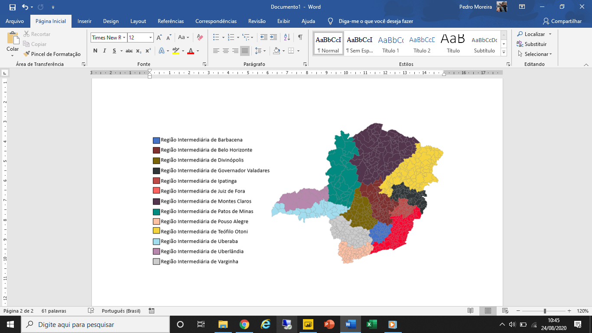
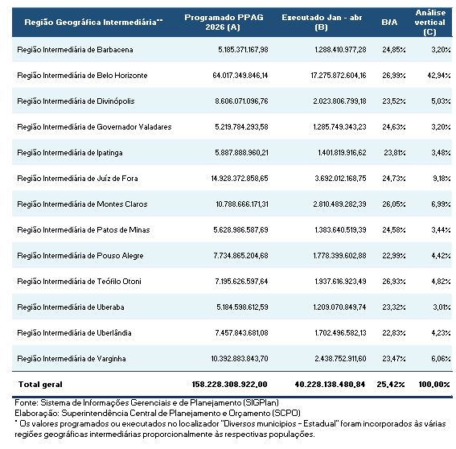
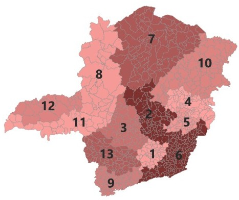
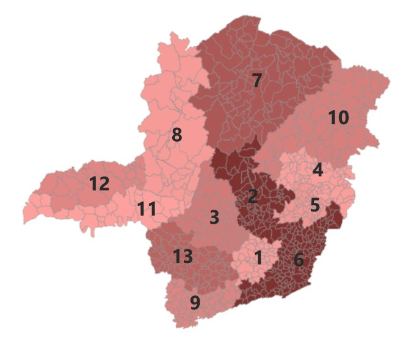
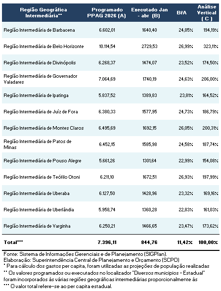
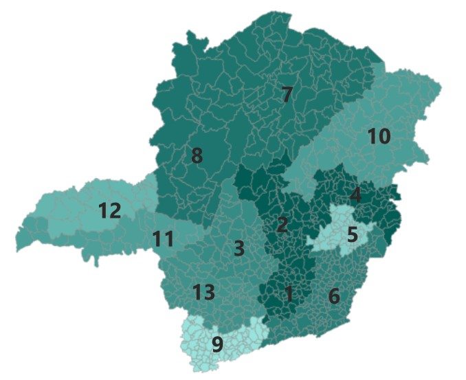
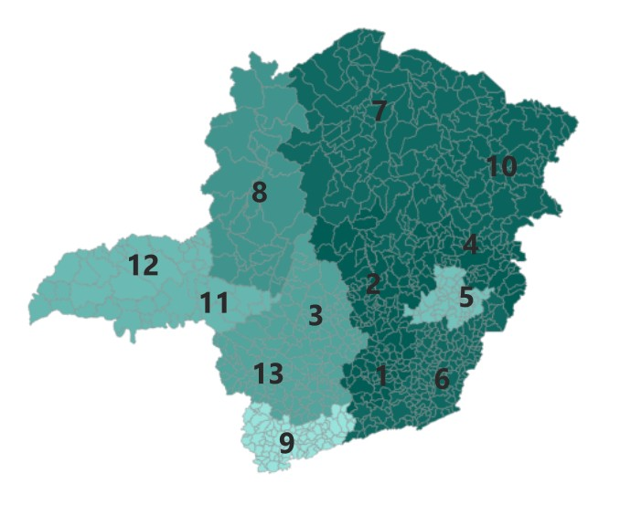

<!-- Trecho do RIM original; sem revisão numérica nem atualização de período. -->

## 2.3 REGIONALIZAÇÃO DOS PROGRAMAS 

Nesta seção será abordada a regionalização dos valores programados e executados nas ações do Plano até o período monitorado.

O PPAG 2024-2027 utilizou como critério de regionalização as Regiões Geográficas Intermediárias, que foram adotadas pelo Instituto Brasileiro de Geografia e Estatística – IBGE, em 2017. Com essa nova metodologia, retratada no Mapa 1, o Estado de Minas Gerais passa a ser dividido em 13 regiões, quais sejam:

1.  Região Intermediária de Barbacena;

2.  Região Intermediária de Belo Horizonte;

3.  Região Intermediária de Divinópolis;

4.  Região Intermediária de Governador Valadares;

5.  Região Intermediária de Ipatinga;

6.  Região Intermediária de Juiz de Fora;

7.  Região Intermediária de Montes Claros;

8.  Região Intermediária de Patos de Minas;

9.  Região Intermediária de Pouso Alegre;

10. Região Intermediária de Teófilo Otoni;

11. Região Intermediária de Uberaba;

12. Região Intermediária de Uberlândia;

13. Região Intermediária de Varginha.

Mapa 1 - Regiões Geográficas Intermediárias de Minas Gerais – IBGE

Fonte: Dados da Superintendência Central de Planejamento e Orçamento - SCPO/SEPLAG-MG e Instituto Brasileiro de Geografia e Estatística - IBGE

Nesse sentido, o termo regionalização passa a ser usado para se referir à distribuição da programação e execução das metas físicas e orçamentárias contidas nos programas e ações governamentais nos municípios estaduais entre as 13 regiões, em substituição à divisão por territórios adotada durante a vigência do PPAG 2024-2027.

Salienta-se que é possível a existência de programas governamentais cuja entrega/valor/benefício gerado contemplará, de forma indivisível, uma ou mais regiões ou o estado de Minas Gerais como um todo. Para tais casos não há que se falar em municipalização das metas. Sendo assim, a alocação espacial da programação e execução das metas físicas e orçamentárias contidas no PPAG ocorrerá de três maneiras distintas:

- Municipal;

- Regional;

- Estadual.

Destaca-se, ainda, que para viabilizar a análise sobre a regionalização das ações, os valores programados ou executados no localizador “Diversos Municípios – Estadual” foram incorporados às Regiões Intermediárias, proporcionalmente às respectivas populações.

Na Tabela 7, é possível visualizar os dados consolidados da programação e execução global desses programas, por região.

**Tabela 7** - Valor global programado e executado nos programas por Região Geográfica Intermediária - Minas Gerais - 2° bimestre de 2026

R\$1,00

Conforme a tabela acima, as regiões que apresentaram maior participação na execução das ações dos programas do PPAG, no segundo bimestre de 2026, foram: Região Intermediária de Belo Horizonte (42,94%), Juiz de Fora (9,18%) e Montes Claros (6,99%), totalizando uma execução de 59,11%.

Considerando, por outro lado, a correlação entre os dispêndios programados e executados, as regiões que apresentaram as maiores taxas foram: a Região Intermediária de Belo Horizonte (26,99%), Teófilo Otoni (26,93%), Montes Claros (26,05%) e Barbacena (24,85%)

Para melhor visualização dos dados, utilizou-se o mapa do estado de Minas Gerais com os valores do gasto global programado de 2026 e a execução financeira do 2° bimestre, alocados por Região Geográfica Intermediária.

**Mapa 2 -** Gasto Global Programado por Região Geográfica Intermediária – Minas Gerais – 2026

Fonte: Dados da Superintendência Central de Planejamento e Orçamento - SEPLAG-MG e Instituto Brasileiro de Geografia e Estatística - IBGE

**Mapa 3 -** Gasto Global Executado por Região Geográfica Intermediária –Minas Gerais – 2° Bimestre 2026

Fonte: Dados da Superintendência Central de Planejamento e Orçamento - SEPLAG-MG e Instituto Brasileiro de Geografia e Estatística - IBGE

**Legenda**

<table>
<colgroup>
<col style="width: 50%" />
<col style="width: 50%" />
</colgroup>
<tbody>
<tr class="odd">
<td><ol type="1">
<li>
Região Intermediária de Barbacena
</li>
</ol></td>
<td>8. Região Intermediária de Patos de Minas</td>
</tr>
<tr class="even">
<td><ol start="2" type="1">
<li>
Região Intermediária de Belo Horizonte
</li>
</ol></td>
<td>9. Região Intermediária de Pouso Alegre</td>
</tr>
<tr class="odd">
<td><ol start="3" type="1">
<li>
Região Intermediária de Divinópolis
</li>
</ol></td>
<td>10. Região Intermediária de Teófilo Otoni</td>
</tr>
<tr class="even">
<td><ol start="4" type="1">
<li>
Região Intermediária de Governador Valadares
</li>
</ol></td>
<td>11. Região Intermediária de Uberaba</td>
</tr>
<tr class="odd">
<td><ol start="5" type="1">
<li>
Região Intermediária de Ipatinga
</li>
</ol></td>
<td>12. Região Intermediária de Uberlândia</td>
</tr>
<tr class="even">
<td><ol start="6" type="1">
<li>
Região Intermediária de Juiz de Fora
</li>
</ol></td>
<td>13. Região Intermediária de Varginha</td>
</tr>
<tr class="odd">
<td><ol start="7" type="1">
<li>
Região Intermediária de Montes Claros
</li>
</ol></td>
<td></td>
</tr>
</tbody>
</table>

Nos Mapas apresentados acima, a intensidade das cores utilizadas relaciona-se ao grau de proximidade da programação e execução em relação à média regional estadual.

Assim, no mapa 2, as regiões com coloração mais escura são aquelas que detiveram o valor global programado superior a R\$ 12.171.408.378,62 que é a média geral das regiões. Seguindo a mesma lógica, no mapa 3, que se refere ao valor global executado, as mais escuras são aquelas que apresentaram valores superiores a R\$ 3.094.472.190,83.

As regiões de cor mais clara, diz respeito às localidades que estão entre o valor mínimo e a média. No caso do mapa 2 (gastos programados), o valor mínimo foi R\$ 5.184.598.612,59 referente à Região Intermediária de Uberaba e no mapa 3 (gastos executados), na mesma linha de raciocínio, o valor mínimo foi de R\$ 1.209.070.849,74 também na Região Intermediária de Uberaba.

Ressalta-se que a Região Intermediária que denotou os maiores valores de Gasto Global, tanto programado quanto executado, foi a de Belo Horizonte, sendo R\$ 64.017.349.846,14 (programado – mapa 2) e R\$ 17.275.872.604,16 (executado - mapa 3).

Por fim, apresenta-se na tabela 8 a distribuição per capita dos valores programados e executados por regiões intermediárias no 2° bimestre de 2026. O objetivo é evidenciar a proporcionalização dos gastos em relação ao quantitativo populacional das regiões.

Verifica-se que, no período de janeiro a abril de 2026, as regiões que apresentaram maior gasto per capita foram: Região Intermediária de Belo Horizonte (R\$ 2.729,53), Governador Valadares (R\$ 1.740,19) e Montes Claros (R\$ 1.692,15).

Tabela 8 - Gasto per capita\* programado e executado nos programas por Região Geográfica Intermediária - Minas Gerais - 2° bimestre de 2026

R\$1,00

Analogamente, o gasto global programado e executado *per capita* pode também ser visualizado nos mapas abaixo:

Mapa 4 - Gasto Global Programado *Per Capita* por Região Geográfica Intermediária – Minas Gerais – 2026

Fonte: Dados da Superintendência Central de Planejamento e Orçamento - SEPLAG-MG e Instituto Brasileiro de Geografia e Estatística – IBGE

Mapa 5 - Gasto Global Executado *Per Capita* por Região Geográfica Intermediária – Minas Gerais – 2° Bimestre 2026

Fonte: Dados da Superintendência Central de Planejamento e Orçamento - SEPLAG-MG e Instituto Brasileiro de Geografia e Estatística - IBGE

**Legenda**

<table>
<colgroup>
<col style="width: 50%" />
<col style="width: 50%" />
</colgroup>
<tbody>
<tr class="odd">
<td><ol type="1">
<li>
Região Intermediária de Barbacena
</li>
</ol></td>
<td>8. Região Intermediária de Patos de Minas</td>
</tr>
<tr class="even">
<td><ol start="2" type="1">
<li>
Região Intermediária de Belo Horizonte
</li>
</ol></td>
<td>9. Região Intermediária de Pouso Alegre</td>
</tr>
<tr class="odd">
<td><ol start="3" type="1">
<li>
Região Intermediária de Divinópolis
</li>
</ol></td>
<td>10. Região Intermediária de Teófilo Otoni</td>
</tr>
<tr class="even">
<td><ol start="4" type="1">
<li>
Região Intermediária de Governador Valadares
</li>
</ol></td>
<td>11. Região Intermediária de Uberaba</td>
</tr>
<tr class="odd">
<td><ol start="5" type="1">
<li>
Região Intermediária de Ipatinga
</li>
</ol></td>
<td>12. Região Intermediária de Uberlândia</td>
</tr>
<tr class="even">
<td><ol start="6" type="1">
<li>
Região Intermediária de Juiz de Fora
</li>
</ol></td>
<td>13. Região Intermediária de Varginha</td>
</tr>
<tr class="odd">
<td><ol start="7" type="1">
<li>
Região Intermediária de Montes Claros
</li>
</ol></td>
<td></td>
</tr>
</tbody>
</table>

Assim como nos mapas de Gasto Global Programado Geral e de Gasto Global Executado Geral, anteriormente analisados, os mapas de Gasto Global Programado e Executado *per capita* seguem a mesma lógica. Portanto, a intensidade das cores usadas, refere-se ao grau de proximidade da execução em relação à média regional estadual.

Logo, no mapa 4, as regiões com coloração mais escura foram aquelas que detiveram o valor global programado superior a R\$ 6.571,09 que se trata da média geral das regiões. Da mesma forma, no mapa 5, que se refere ao valor global executado, são aquelas que apresentaram valores superiores a R\$ 1620,01

As regiões de coloração mais clara, dizem respeito às localidades que estão entre o valor mínimo e a média. No caso do mapa 4 (gastos programados), o valor mínimo foi R\$ 5.661,26 referente à Região Intermediária de Pouso Alegre, e no mapa 5 (gastos executados), equivale à R\$ 1.301,64 – também referente a Região Intermediária de Pouso Alegre.

Por fim, a Região Intermediária que denotou os maiores valores de Gasto Global, tanto programado quanto executado per capita, foi de Belo Horizonte, em ambos os casos, R\$ 10.114,54 (programado – mapa 4) e R\$ 2.279,53 (executado - mapa 5).

