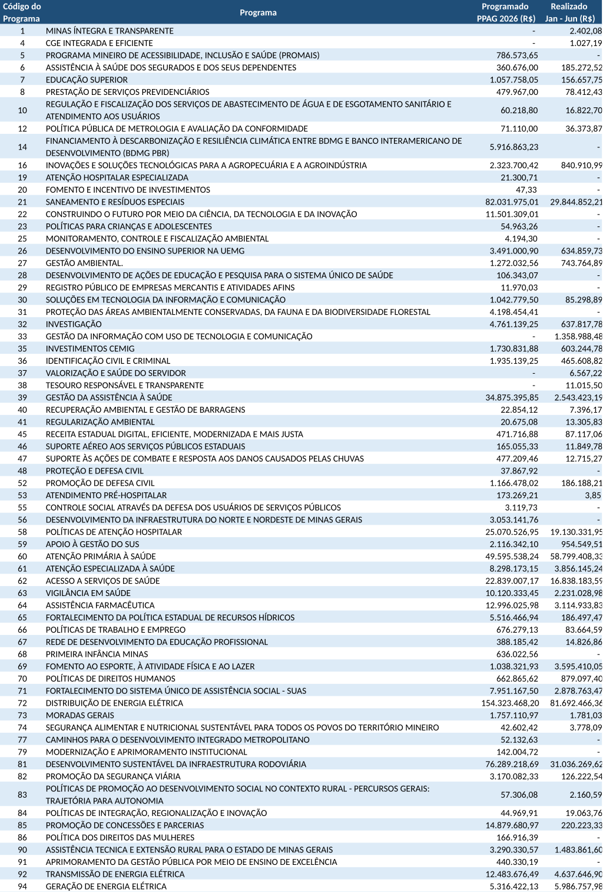
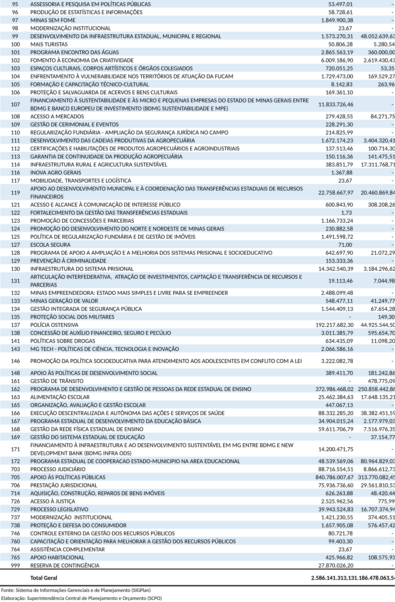
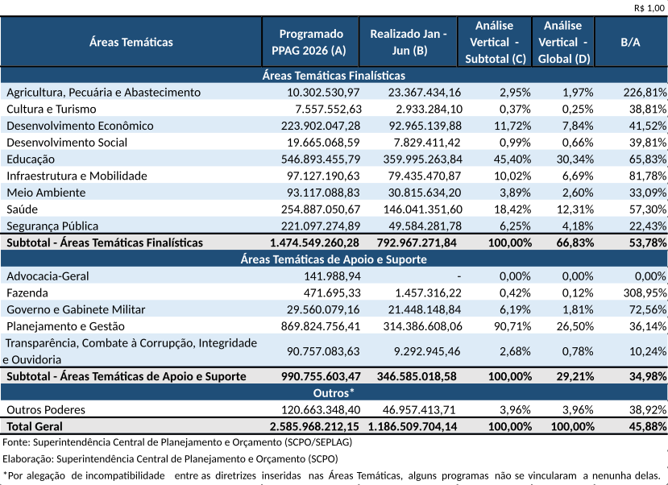
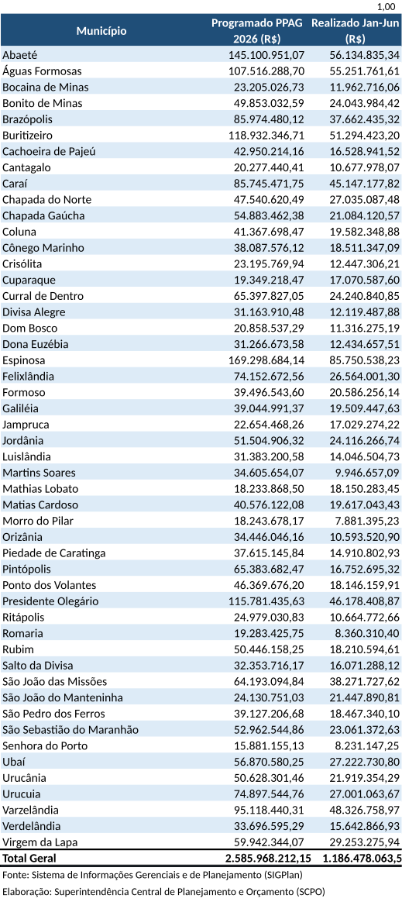
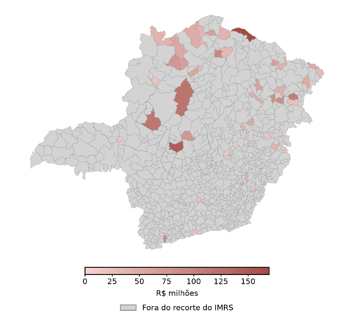
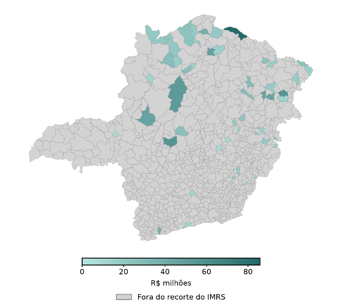

<!-- Trecho do RIM original; sem revisão numérica nem atualização de período. -->

## 2.4 EXECUÇÃO ORÇAMENTÁRIA NOS MUNICÍPIOS CLASSIFICADOS NO EXTRATO IDENTIFICADO COMO DE BAIXO DESEMPENHO DO IMRS

O Índice Mineiro de Responsabilidade Social - IMRS[^1] divulga o perfil de desempenho dos municípios do Estado nas áreas sociais. De acordo com a Lei nº 14.172 de 15/01/2002, o Índice considera as dimensões de assistência social, educação, saúde, emprego, segurança alimentar, segurança pública, habitação, saneamento, transporte, lazer e renda, consoante as variáveis de gênero, etnia, orientação sexual, idade, condição de deficiência, esforço de gestão governamental e participação popular.

A fim de aferir o desempenho dos municípios classificados nas 50 piores posições do IMRS durante o exercício corrente, bem como evidenciar as informações necessárias ao controle da eficácia das ações voltadas para o desenvolvimento social dos municípios com pior desempenho nesse índice, a seção que se segue contém os seguintes demonstrativos:

- Demonstrativo dos Recursos Programados e Aplicados, por Programa, no Desenvolvimento Social dos Municípios Classificados nas Cinquenta Últimas Posições do IMRS;

- Demonstrativo dos Recursos Aplicados no Desenvolvimento Social dos Municípios Classificados nas Cinquenta Últimas Posições do IMRS por Áreas Temáticas

- Demonstrativo dos Recursos Programados e Aplicados nos Municípios Classificados nas Cinquenta Últimas Posições do IMRS.

Os demonstrativos retratarão, além dos recursos aplicados até o bimestre monitorado, o valor programado inicial em cada programa e município. O objetivo é evidenciar o desempenho da política frente ao planejamento.

Na tabela abaixo se encontram os valores programados e executados nos programas do PPAG, que contemplaram os municípios classificados nas 50 piores posições do IMRS.

**  
**

**Tabela 9 -** Demonstrativo dos Recursos Programados e Aplicados, por Programa, no Desenvolvimento Social dos Municípios Classificados nas Cinquenta Últimas Posições do IMRS – Minas Gerais - 3º bimestre de 2026

(Continua)

(Conclusão)

Ressalta-se que os programas indicados na tabela com valor programado igual a zero não possuíam valores planejados para o desenvolvimento dos municípios classificados nas cinquenta piores posições do IMRS. Entretanto, como é sabido, o planejamento não é estático e seu ciclo de funcionamento pressupõe a possibilidade de mudança de escopo, redefinição de metas e adequação da execução. Logo, ocorreu no decorrer do exercício a execução de despesas nesses municípios. Para esses casos a comparação entre o valor programado e o executado ficará prejudicada.

Por sua vez, a tabela 10 apresenta os dados relacionados ao IMRS por Área Temática:

Tabela 10 - Demonstrativo dos Recursos Aplicados no Desenvolvimento Social dos Municípios Classificados nas Cinquenta Últimas Posições do IMRS – 3º bimestre de 2026 - Áreas Temáticas

A maioria dos recursos programados nos municípios que ocupam as 50 últimas posições do IMRS concentrou-se nas Áreas Temáticas Finalísticas, representando 57,02% do valor total programado (R\$ 2.585.968.212,15). Já as Áreas de Apoio e Suporte representaram 38,31%, ou seja, R\$ 990.755.603,47 do montante total programado. Por sua vez, o valor total programado nos Outros Poderes foi de apenas 4,67% - R\$ 120.663.348,40 - do valor total programado nesses municípios. De modo geral, observa-se que as Áreas com maior valor programado foram: Planejamento e Gestão (R\$ 869.824.756,41 ou 33,64% do valor total programado), Educação (R\$ 546.893.455,79 ou 21,15% do valor total programado), Saúde (R\$ 254.887.050,67 ou 9,86%) e Segurança Pública (R\$ 221.097.274,89 ou 8,55%).

Analisando-se a execução do período, se observa a tendência global de concentração dos gastos nas Áreas Temáticas Finalísticas. Do total realizado no período, 66,83% (R\$ 792.967.271,84) foi registrado nas Áreas Finalísticas, com destaque para a Área de Educação que representou 45,40% desse total. Quando se observa o valor executado frente ao valor planejado por área, constata-se que a Agricultura, Pecuária e Abastecimento obteve o maior percentual, tendo em vista que foram executados 226,81% em relação aos recursos planejados. Apesar da grande variação, ainda é uma área temática que concentra apenas 1,97% da execução total até junho.

Por fim, a tabela 11 evidencia os recursos planejados e aplicados nos municípios classificados nas cinquenta piores posições do IMRS:

**Tabela 11** - Demonstrativo dos Recursos Programados e Aplicados nos Municípios Classificados nas Cinquenta Últimas Posições do IMRS – Minas Gerais - 3º bimestre de 2026

De modo a facilitar a visualização dos dados apresentados acima, os mapas 6 e 7 também trazem informações acerca do valor programado e executado dos municípios classificados nas cinquenta últimas posições do IMRS. O grau de intensidade das cores leva em consideração a proximidade ou distanciamento dos valores alocados nesses municípios em relação à média estadual.

**Mapa 6 –** Valor Global Programado nos Municípios Classificados nas Cinquenta Piores Posições do IMRS – Minas Gerais – 2026

Fonte: Sistema de Informações Gerenciais e de Planejamento (SIGPlan) e Instituto Brasileiro de Geografia e Estatística (IBGE).

Elaboração: Superintendência Central de Planejamento e Orçamento (SCPO).

Mapa 7 - Valor Global Executado nos Municípios Classificados nas Cinquenta Últimas Posições do IMRS – Minas Gerais – 3° Bimestre de 2026

Fonte: Sistema de Informações Gerenciais e de Planejamento (SIGPlan) e Instituto Brasileiro de Geografia e Estatística (IBGE).

Elaboração: Superintendência Central de Planejamento e Orçamento (SCPO).

Analisando-se o mapa 6, as localidades com coloração mais escura são aquelas cujo valor global programado para 2026 está bem próximo ou ultrapassa a média estadual, que é de aproximadamente R\$ R\$ 185.496.258,99). Nesse aspecto, constata-se que o município de Espinosa R\$ 169.298.684,14 foi o que mais se aproximou a ela.

Por sua vez, o Mapa 7 evidencia o valor executado acumulado até o 3º bimestre de 2026, considerando a média estadual por município de R\$ 79.425.189,42. Entre os municípios classificados nas cinquenta últimas posições do IMRS, apenas Espinosa (R\$ 85.750.538,23) ultrapassou esse valor. Entre os municípios que permaneceram abaixo da média, Abaeté (R\$ 56.134.835,34) e Águas Formosas (R\$ 55.251.761,61) foram os que mais se aproximaram desse patamar.

