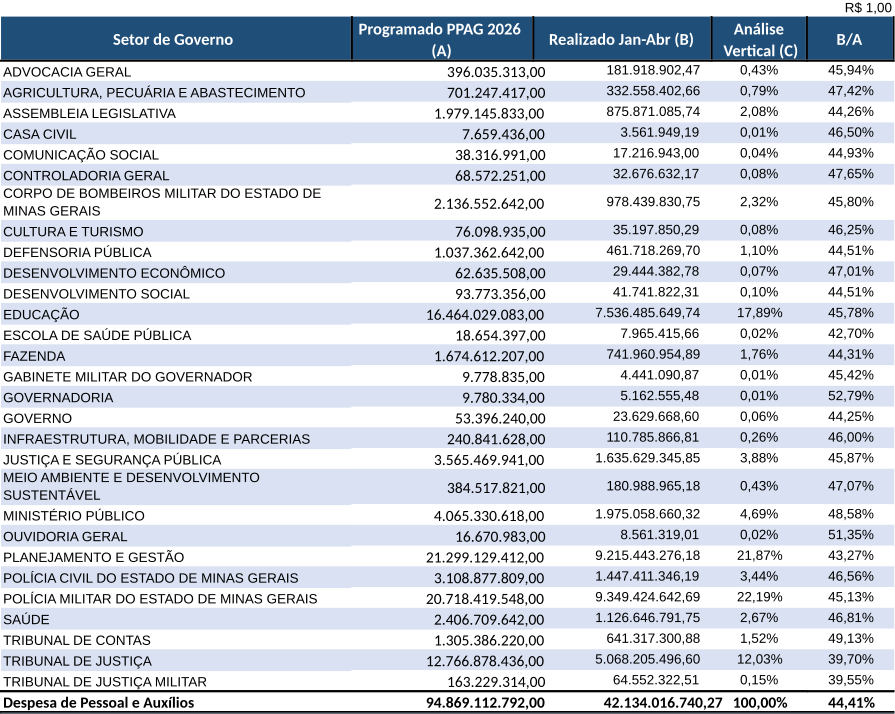
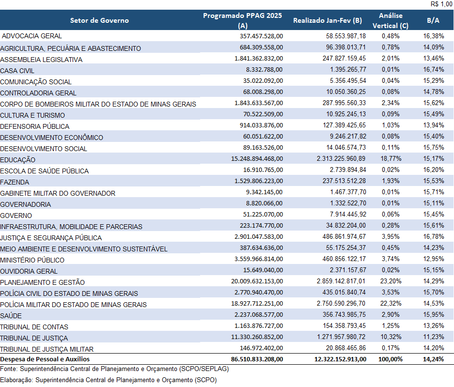

<!-- Trecho do RIM original; sem revisão numérica nem atualização de período. -->

## 2.5 DETALHAMENTO DA EXECUÇÃO DA DESPESA DE PESSOAL E AUXÍLIOS 

A partir do PPAG 2024-2027, exercício 2026, a metodologia de elaboração de programas e ações com foco nas políticas públicas foi continuada, entretanto, as despesas com pessoal e auxílios foram alocadas, na sua grande maioria, em uma única ação padronizada. Assim, salvo exceções, as Unidades Orçamentárias criaram uma ação 2417 – “Remuneração de Pessoal Ativo e Encargos Sociais”, sob sua responsabilidade, dentro do programa 705 – “Apoio às Políticas Públicas”, sob responsabilidade da Secretaria de Estado de Planejamento e Gestão – SEPLAG, para concentrar sua despesa de pessoal e auxílios.

Importante ponderaram que algumas Unidades Orçamentárias não possuem a ação 2417, tendo suas despesas de pessoal e auxílio alocadas em demais ações, sendo essas: Polícia Militar de Minas Gerais (PMMG), EGE-SEPLAG, Secretaria de Estado de Educação (SEE), Corpo de Bombeiros Militar do Estado de Mias Gerais (CBMMG), Fundação Helena Antipoff (FHA), Instituto de Desenvolvimento do Norte e Nordeste de Minas Gerais (IDENE), Empresa Mineira de Comunicação (EMC) e Fundo Financeiro de Previdência (FUNFIP).

Ainda, existem Unidades Orçamentárias que, além da ação padronizada 2417 também possuem outras ações para pagamento de pessoal, como: Secretaria de Estado de Agricultura, Pecuária e Abastecimento de Minas Gerais (SEAPA), Secretaria de Estado de Justiça e Segurança Pública (SEJUSP), Secretaria de Estado de Desenvolvimento Social (SEDESE), Secretaria de Estado de Planejamento e Gestão de Minas Gerais (SEPLAG), Polícia Civil de Minas Gerais (PCMG), Fundação João Pinheiro (FJP), Instituto de Previdência dos Servidores Militares do Estado de Minas Gerais (IPSM), Fundação Educacional Caio Martins (FUCAM), Fundação Clóvis Salgado (FCS), Empresa de Pesquisa Agropecuária de Minas Gerais (EPAMIG).

Para fins de análise e segregação das ações, entende-se por despesa de pessoal e auxílios a programação e execução das despesas no Grupo de Despesa 1 (Pessoal e Encargos Sociais), com exceção do IPU 9 (Recursos Recebidos para Precatórios e Sentenças Judiciais); em todos os itens do elemento 34 (Outras Despesas Decorrentes de Contratos de Terceirização) e no IPU 7 (Recursos Recebidos para Auxílios).

Apesar da alteração da alocação das despesas de pessoal e auxílios, a transparência a respeito ao orçamento aplicado na implementação e manutenção da política pública foi mantida, uma vez que é possível identificar e acompanhar a previsão e a execução dessas despesas dentro de cada unidade orçamentária.

Evidencia-se a partir da Tabela 12 os dados de programação e execução das despesas de pessoal e auxílio de acordo com o setor de governo:

**Tabela 12 -** Programação e Execução da Despesa de Pessoal e Auxílios por Setor de Governo - Minas Gerais - 3º bimestre de 2026

Os setores de governo reúnem órgãos, secretarias de estado e entidades subordinadas por vinculação (autarquias, fundações, empresas dependentes e empresas controladas), que desempenham atividades relacionadas a determinado campo de interesse público. Destaca-se que os órgãos autônomos são independentes e não apresentam vínculo de subordinação com outro órgão. Sendo assim, inserem-se em setores próprios.

Os setores com maior execução de Pessoal e Auxílios até o primeiro bimestre foram: Polícia Militar do Estado de Minas do Estado de Minas Gerais (22,19%), Planejamento de Gestão (21,89%), Educação (17,89%), e Tribunal de Justiça (12,03%).

Já no comparativo dos valores programados em 2026 e executados até o período analisado, os setores com maior percentual de execução foram: Governadoria (52,79%), Ouvidoria Geral (51,35%), Tribunal de Contas (49,13%) e Ministério Público (48,58%).

